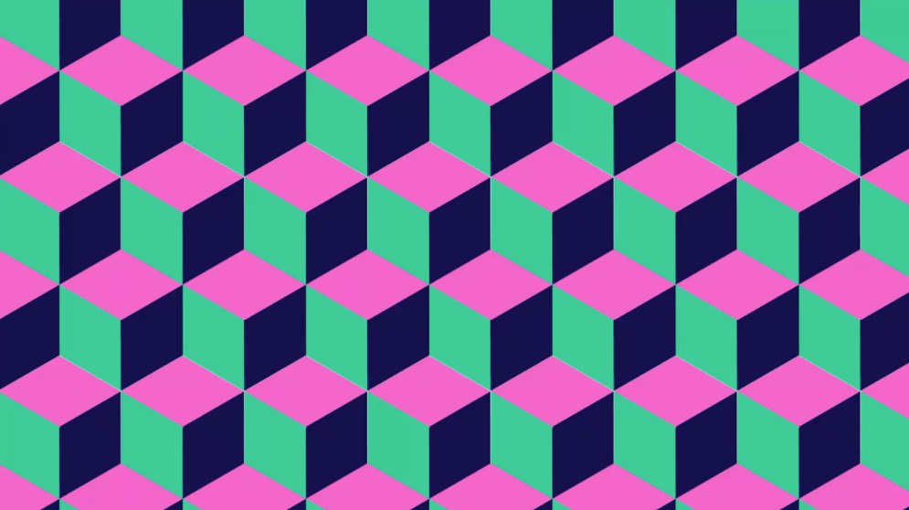
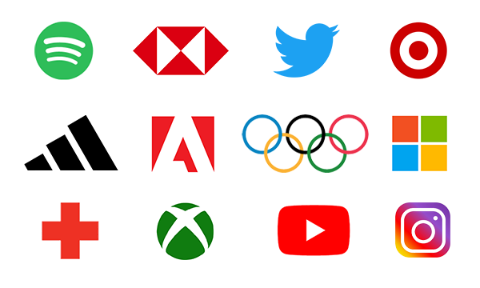
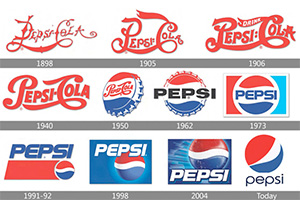
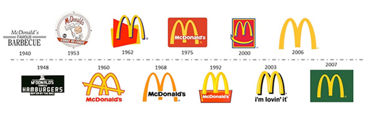
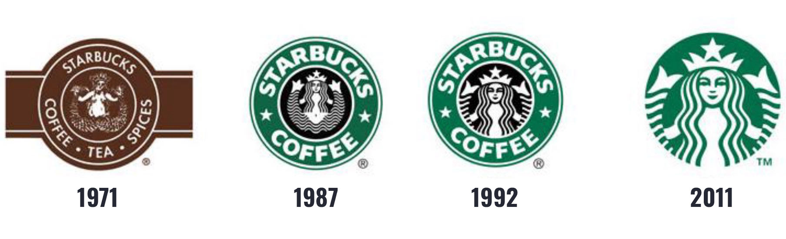
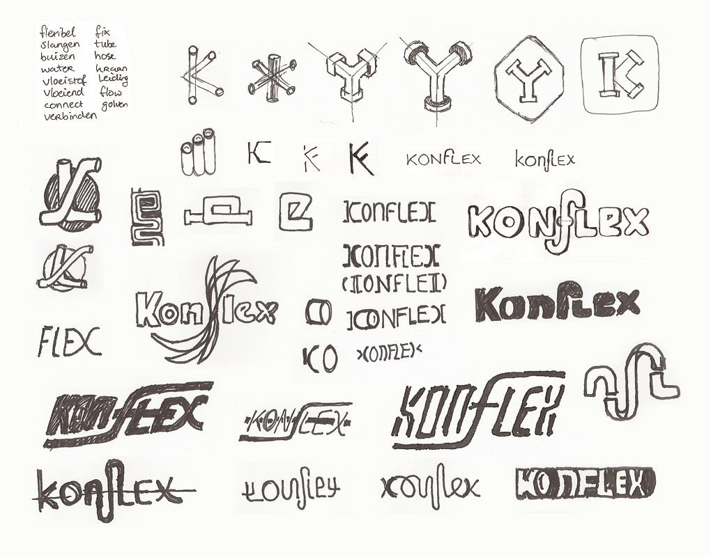
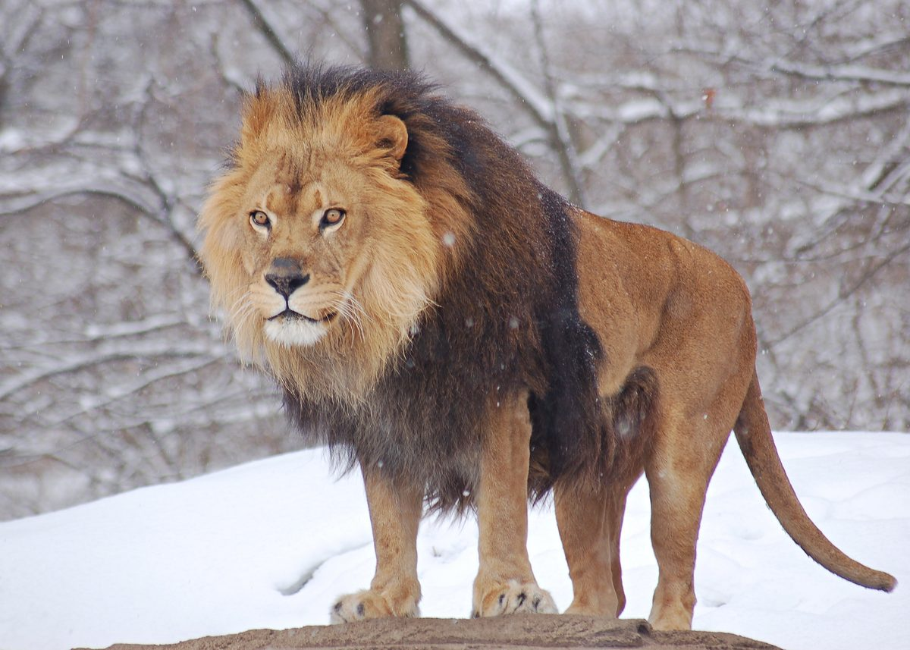

<!-- .slide: class="bleed dark" data-background-color="#111111" -->

  

  
Design1 · P1 · Week 45 · GLR Media Creative

  <h1 class="title title--xl" style="color:#fff">Logo's</h1>
  
Een merk herken je in één oogopslag. Vandaag leer je hoe zo'n logo in elkaar zit.

  
Design1 · Logo's01

Note: Welkom. Vorige lessen ging het over vorm, kleur en typografie; vandaag is logo's aan de beurt: het onderdeel waarbij al die losse stukken samenkomen. Rode draad van de les (ABT): je herkent merken moeiteloos aan één klein detail EN dat lijkt simpel, MAAR achter elk logo zit een bewuste keuze van vorm, kleur en typografie, DAAROM leer je vandaag hoe een logo is opgebouwd en ga je zelf schetsen. Laat deze slide staan terwijl studenten binnenkomen.

---

<!-- .slide: class="dark" data-background-color="#111111" -->

Even opwarmen · Denk – deel

Ogen dicht: welk merk zie je bij deze drie aanwijzingen?

  
01
<h3>Een gele boog die op een M lijkt</h3>
… dat is <strong>McDonald's</strong>.

  
02
<h3>Een appel met rechts een hap eruit</h3>
… dat is <strong>Apple</strong>.

  
03
<h3>Drie strepen, schuin omhoog</h3>
… dat is <strong>Adidas</strong>.

Design1 · Logo's02

Note: Gagné 1 — aandacht trekken. Doe de aanwijzingen één voor één hardop en laat de klas het merk roepen (of noemen aan de buur). Klik pas daarna de fragmenten open. Kern: je hebt het logo niet gezien, maar je zag het meteen voor je. Een klein detail is al genoeg om een merk te herkennen — dat is de kracht van een logo. Aan het eind van de les kun je uitleggen hoe zo'n logo is opgebouwd en heb je je eigen eerste schetsen gemaakt.

---

Afspraken

## Zo werken we vandaag

  
01<h3>Geen telefoons</h3>
Je laptop is je gereedschap; je telefoon blijft in je tas.

  
02<h3>Niet eten of drinken</h3>
Alleen drinken uit een afgesloten fles.

  
03<h3>Even melden</h3>
Laat het weten als je het lokaal verlaat.

Design1 · Logo's03

Note: Korte herhaling van de vaste afspraken. Geen discussie, door naar de planning.

---

Planning

## Eerst kijken en oefenen, dan zelf ontwerpen

  
5 min
<h3>Leer- en lesdoelen</h3>

  
15 min
<h3>Uitleg: wat is een logo + Kahoot-check</h3>

  
10 min
<h3>Oefening: schetsen (de leeuw)</h3>

  
30 min
<h3>Opdracht 1: logo voor je eigen gamebedrijf</h3>

  
rest
<h3>Voorbereiding toets + afsluiting</h3>

Design1 · Logo's04

Note: Loop de planning kort door. Benadruk dat je vandaag eerst leert hoe een logo is opgebouwd, dat je daarna leert schetsen (een vaardigheid die je bij de toets nodig hebt) en dat je aan het eind vooruitkijkt naar de toets van week 47 en het onderzoeksdocument. Houd de laatste minuten vrij voor de afsluiting.

---

Leerdoelen P1 · Hierop word je in de toets beoordeeld

## Een logo is de plek waar alle P1-doelen samenkomen

  
01
<h3>Vorm</h3>
Je kiest en gebruikt basisvormen om de uitstraling, betekenis en duidelijkheid van een ontwerp te versterken.

  
02
<h3>Kleur</h3>
Je kiest kleuren die passen bij een gewenst gevoel of een bepaalde sfeer en legt uit waarom.

  
03
<h3>Typografie</h3>
Je kiest typografie die past bij een gewenste emotie of sfeer en legt uit waarom.

  
04
<h3>Ideeën &amp; keuze</h3>
Je bedenkt verschillende ideeën, onderzoekt mogelijkheden en maakt een onderbouwde keuze.

  Vandaag
  
In een logo komen <strong>vorm, kleur en typografie</strong> samen. Doel 4 (ideeën &amp; keuze) oefen je vandaag met <strong>schetsen</strong>.

Design1 · Logo's05

Note: Gagné 2 — doelen. Dit zijn de vier doelen van P1; precies deze vier staan straks als criteria in de rubric van de toets. Vorm, kleur en typografie hebben we gehad; een logo is de plek waar die drie samenkomen. Doel 4 (ideeën en keuze) loopt overal doorheen: steeds meerdere opties bekijken en daarna onderbouwd kiezen — vandaag oefen je dat met schetsen.

---

Lesdoelen logo's

## Aan het einde van deze les kun je …

1. **uitleggen** wat een logo is en waarvoor een merk het gebruikt;
2. de belangrijkste **onderdelen** van een logo **herkennen** en **benoemen**;
3. verschillende logo-ideeën **schetsen** op papier en daaruit onderbouwd één idee **kiezen**.

Design1 · Logo's06

Note: Gagné 2. Drie doelen, van begrijpen (wat is een logo) via analyseren (onderdelen herkennen) naar creëren (zelf schetsen en kiezen). Doel 3 toets je straks in de leeuw-oefening en in opdracht 1: niet alleen tekenen, maar ook een idee kiezen en uitleggen waarom.

---

Terugblik · Typografie · Denk – deel

## Eerst even terug: wat weet je nog van typografie?

  
01
<h3>Wat is het verschil tussen serif en sans serif?</h3>
De <strong>schreef</strong> (het voetje): serif = klassiek en betrouwbaar, sans serif = strak en modern.

  
02
<h3>Waar let je op bij typografie?</h3>
Op drie dingen: <strong>hiërarchie</strong>, <strong>interlinie</strong> en <strong>kerning</strong>.

Design1 · Logo's07

Note: Gagné 3 — voorkennis activeren. Laat studenten eerst één minuut met hun buur overleggen, haal daarna 3 à 4 antwoorden op. Klik dan de fragmenten open. Vraag 1: de schreef is het kleine voetje; serif voelt klassiek en betrouwbaar, sans serif strak en modern. Vraag 2: hiërarchie (wat lees je eerst), interlinie (ruimte tussen de regels) en kerning (ruimte tussen de letters). Sluit af: bij een logo telt kerning extra, want daar valt elke oneffenheid op — en vandaag voeg je daar de opbouw van een logo aan toe.

---

Wat is een logo?

## Een logo maakt een merk in één oogopslag herkenbaar

  Definitie
  
Een logo is een <strong>grafisch symbool</strong> — een beeld en/of een woord — dat een merk, product of organisatie <strong>herkenbaar</strong> maakt en de kernwaarden uitdraagt.

<figure class="strip-wrap">
  
</figure>

Design1 · Logo's08

Note: Gagné 4 — inhoud presenteren. Lees de definitie voor en benoem de twee kernwoorden: grafisch symbool en herkenbaar. Wijs op de strip: al deze merken zijn direct herkenbaar, ook zonder de naam erbij. Vraag kort: welk logo herken je meteen? Waarom? (Vorm, kleur of letters.)

---

Onderdelen van een logo

## Een logo bestaat uit een beeldmerk en/of een woordmerk

  

    1 · Beeldmerk
    
<svg viewBox="0 0 64 64"><rect x="6" y="6" width="52" height="52" rx="13" fill="#111111"/><path d="M26 20 L46 32 L26 44 Z" fill="#A6E22E"/></svg>

    <h3>Alleen een symbool</h3>
    
Een vorm of afbeelding, zonder woorden. Denk aan de appel van Apple.

  

  

    2 · Woordmerk
    
PIXEL

    <h3>Alleen de naam</h3>
    
De merknaam in een specifiek lettertype. Denk aan Google of Coca-Cola.

  

  

    3 · Combimark
    
<svg viewBox="0 0 64 64"><rect x="6" y="6" width="52" height="52" rx="13" fill="#111111"/><path d="M26 20 L46 32 L26 44 Z" fill="#A6E22E"/></svg>PIXEL

    <h3>Symbool + naam</h3>
    
Beeld en woord samen. Het meest gebruikte type logo.

  

Design1 · Logo's09

Note: Gagné 4 — segmenteren. Klik de kaarten één voor één open. Beeldmerk: alleen een symbool, zoals de appel van Apple — herkenbaar zonder naam. Woordmerk: alleen de naam in een eigen lettertype, zoals Google of Coca-Cola. Combimark: symbool én naam samen, het meest gebruikte type. Vraag bij elke kaart: ken je hier een voorbeeld van? Zo sluit je aan bij wat studenten al weten.

---

Waarvoor gebruik je een logo?

## Een goed logo vertelt iets over het bedrijf

  
Herkenbaarheid<h3>Direct te herkennen</h3>
Op websites, producten en advertenties weet je meteen welk merk het is.

  
Huisstijl<h3>Het ankerpunt</h3>
Onderdeel van de huisstijl: kleuren, lettertypes en vormgeving die consistent terugkomen.

  
Betekenis<h3>Het verhaal</h3>
Een goed logo vertelt iets over de activiteiten, waarden of visie van een bedrijf.

  Huisstijl
  
De <strong>visuele identiteit</strong> van een merk: het logo, het kleurenschema, de lettertypes en de vormgeving die je overal consistent gebruikt.

Design1 · Logo's10

Note: Gagné 4. Een logo heeft drie functies: herkenbaarheid (je weet meteen welk merk het is), huisstijl (het is het ankerpunt van alle visuele keuzes) en betekenis (het vertelt iets over waar het bedrijf voor staat). Klik dan de definitie van huisstijl open — die is belangrijk voor de toets, want in je onderzoeksdocument en je logo gebruik je die consistentie.

---

Evolutie van logo's · Kijkvraag

## Wat verandert er aan deze logo's door de jaren heen?

  <figure><figcaption>Pepsi</figcaption></figure>
  <figure><figcaption>McDonald's</figcaption></figure>
  <figure><figcaption>Starbucks</figcaption></figure>

  Wat je ziet
  
Steeds <strong>eenvoudiger</strong>: minder details, strakkere vormen en minder kleuren — zodat het logo klein én groot werkt, digitaal én op papier.

Design1 · Logo's11

Note: Gagné 5 — leerbegeleiding met voorbeelden. Laat studenten 30 seconden kijken en vraag: wat valt je op? Haal antwoorden op, klik dan het kader open. Kern: logo's worden door de jaren heen steeds eenvoudiger — minder details, strakkere vormen, minder kleuren. Waarom? Een logo moet werken als app-icoon van 2 mm én als reclamebord van 20 meter. Details verdwijnen dan. Dit is precies wat je straks met de leeuw oefent: de essentie vasthouden.

---

Check · Kahoot

## Test je logo-kennis

  

    

      
01
<h3>Ga naar <a href="https://kahoot.it">kahoot.it</a></h3>
Open het in je browser op je laptop.

      
02
<h3>Vul de code in</h3>
De code staat op het bord.

      
03
<h3>Gebruik je echte naam</h3>
Geen nickname — dan kan ik je resultaat zien.

    

  

  

    

      Kahoot · logo's
      
Een korte quiz over wat je net hebt geleerd. Wees snel, maar denk na.

    

  

Design1 · Logo's12

Note: Gagné 6 — prestatie uitlokken (retrieval). Start de Kahoot: https://play.kahoot.it/v2/?quizId=82f5dcdd-d82e-45aa-a66e-1cb1dc24488c&hostId=9def27b2-81a6-42bc-9a84-59d206812f1d — de code wordt op het bord geprojecteerd; studenten gaan naar kahoot.it. Gebruik de tussenstand om te checken wat nog niet duidelijk is. Bespreek de vragen die veel fout gaan kort na.

---

Schetsen · Waarom op papier?

## Schetsen zet je ideeën snel op papier, zonder oordeel

  

    <figure>
      
      <figcaption>Zo begint bijna elk logo: eerst op papier, dan pas digitaal.</figcaption>
    </figure>
  

  

    

      
01
<h3>Snel vastleggen</h3>
Zet een idee op papier voordat je het vergeet of wegredeneert.

      
02
<h3>Vrij experimenteren</h3>
Brainstorm en probeer gekke ideeën, zonder de beperkingen van een scherm.

      
03
<h3>Je hoofd leegmaken</h3>
Zo houd je overzicht en zie je je plannen voor je.

    

  

Design1 · Logo's13

Note: Gagné 5. Op papier denken gaat sneller en vrijer dan op de computer: je hoeft niets netjes te maken en kunt meteen doorgaan naar het volgende idee. Wijs op de afbeelding: dit is hoe een echt logo-ontwerp begint — een vel vol ruwe schetsen, daarna pas de uitwerking. Klik de drie redenen één voor één open.

---

Voorbereiding · Voor we gaan schetsen

## Pak drie vellen papier en een potlood

  

    

      
01
<h3>Pak je materiaal</h3>
Drie vellen papier en een potlood.

      
02
<h3>Schrijf je naam op elk vel</h3>
Op alle drie de vellen.

      
03
<h3>Nummer de vellen</h3>
Vel 1, vel 2 en vel 3.

    

  

  

    

      
Je naam1

      
Je naam2

      
Je naam3

    

  

Design1 · Logo's14

Note: Gagné 6 — voorbereiding op de oefening. Laat studenten drie vellen papier en een potlood pakken en op elk vel hun naam schrijven. Daarna nummeren ze de vellen 1, 2 en 3; elke ronde komt op het bijbehorende vel. Wacht tot iedereen klaar is voordat je ronde 1 start.
---

Oefening · De drie rondes

## Een schets hoeft niet perfect te zijn — hij moet een idee vastleggen

  
Ronde 1<h3>5 minuten</h3>
Teken een leeuw zo gedetailleerd als je kunt.

  
Ronde 2<h3>2 minuten</h3>
Teken de leeuw opnieuw, nu alleen de hoofdvormen.

  
Ronde 3<h3>1 minuut</h3>
Teken de leeuw opnieuw in alleen de essentie.

Elke ronde krijg je minder tijd. <strong>Wat blijft er over van de leeuw als je bijna niets meer mag tekenen?</strong>

Design1 · Logo's15

Note: Gagné 6 — oefenen. Laat studenten papier en een potlood pakken. Vertel: een schets hoeft niet perfect te zijn; hij moet snel een idee vastleggen. Je gaat de leeuw drie keer tekenen, met steeds minder tijd. Elke ronde heeft een eigen focus. Benadruk dat het niet om mooi tekenen gaat, maar om het vasthouden van de essentie — precies wat een logo ook doet.

---

  

    <figure></figure>
  

  

    
Ronde 1 · 5 minuten · Vel 1

    <h2>Teken een leeuw zo gedetailleerd als je kunt</h2>
    

      

        <svg viewBox="0 0 120 120" aria-hidden="true">
          <circle class="t-track" cx="60" cy="60" r="54"></circle>
          <circle class="t-prog" cx="60" cy="60" r="54"></circle>
        </svg>
        
5:00Ronde 1

      

      

        <button class="t-btn t-start" type="button">Start</button>
        <button class="t-btn t-reset" type="button">Reset</button>
      

    

  

Design1 · Logo's16

Note: Start de timer. Ronde 1: zo gedetailleerd mogelijk — manen, ogen, snorharen, alles. Loop rond. Na 5 minuten: leg de tekening weg, pak een nieuw blaadje voor ronde 2.

---

  

    <figure></figure>
  

  

    
Ronde 2 · 2 minuten · Vel 2

    <h2>Teken de leeuw opnieuw, nu alleen de hoofdvormen</h2>
    

      

        <svg viewBox="0 0 120 120" aria-hidden="true">
          <circle class="t-track" cx="60" cy="60" r="54"></circle>
          <circle class="t-prog" cx="60" cy="60" r="54"></circle>
        </svg>
        
2:00Ronde 2

      

      

        <button class="t-btn t-start" type="button">Start</button>
        <button class="t-btn t-reset" type="button">Reset</button>
      

    

  

Design1 · Logo's17

Note: Start de timer. Ronde 2: nieuwe tekening, alleen de hoofdvormen — het hoofd, de manen en de snuit, maar laat kleine details weg. Na 2 minuten: leg weg, nieuw blaadje voor ronde 3.

---

  

    <figure></figure>
  

  

    
Ronde 3 · 1 minuut · Vel 3

    <h2>Teken de leeuw opnieuw in alleen de essentie</h2>
    

      

        <svg viewBox="0 0 120 120" aria-hidden="true">
          <circle class="t-track" cx="60" cy="60" r="54"></circle>
          <circle class="t-prog" cx="60" cy="60" r="54"></circle>
        </svg>
        
1:00Ronde 3

      

      

        <button class="t-btn t-start" type="button">Start</button>
        <button class="t-btn t-reset" type="button">Reset</button>
      

    

  

Design1 · Logo's18

Note: Start de timer. Ronde 3: één minuut, alleen de essentie. Welke twee of drie lijnen maken de leeuw nog herkenbaar? Laat de tekeningen daarna liggen voor de vergelijking.

---

Vergelijken · Met je buur

## Herken je de 1-minuut-schets nog als leeuw?

  
Kijkvraag 1<h3>Welke is het duidelijkst?</h3>
Bekijk elkaars drie leeuwen. Welke vertelt het meest met het minste?

  
Kijkvraag 2<h3>Wat blijft er over?</h3>
Wat is er nog van de leeuw te zien als je alleen de essentie tekent?

  De les voor je logo
  
Een sterk logo werkt nog als je alle details weglaat: het is <strong>eenvoudig</strong> en toch <strong>herkenbaar</strong>.

Design1 · Logo's19

Note: Gagné 7 — feedback. Laat studenten hun drie leeuwen met hun buur vergelijken. Vraag 1: welke is het duidelijkst? Vaak is dat niet de gedetailleerde van 5 minuten, maar de simpele — mits de essentie klopt. Vraag 2: wat blijft er over? Meestal de manen, de snuit en de ogen. Trek de lijn naar logo's: ook daar gaat het om de essentie. Dit sluit aan bij de evolutie van logo's (slide 11): minder details, sterker beeld.

---

Opdracht 1 · Individueel · Figma · tot 10 min voor het einde

## Ontwerp een logo voor je eigen gamebedrijf

  

    

      
01
<h3>Kies je bedrijfsnaam</h3>
Gebruik je eigen naam als bedrijfsnaam.

      
02
<h3>Schets minimaal 10 ideeën</h3>
Op papier, snel en zonder oordeel — net als de leeuw.

      
03
<h3>Werk je beste idee uit in Figma</h3>
Denk aan vorm, kleur en typografie.

      
04
<h3>Onderbouw je keuzes</h3>
Leg kort uit waarom je voor deze vorm, kleur en typografie koos.

    

  

  

    

      
Inleveren

      <ul class="check" style="margin-top:6px">
        <li><strong>Foto van je 10 schetsen</strong></li>
        <li><strong>Je uitgewerkte logo</strong> in Figma, geëxporteerd als afbeelding</li>
        <li><strong>Korte onderbouwing</strong> waarom deze vorm, kleur en typografie?</li>
      </ul>
    

  

Design1 · Logo's20

Note: Opdracht 1 (ook in de lesstof: DESIGN1 / Periode 1 / Opdracht 1). Je ontwerpt een logo voor je eigen gamebedrijf en gebruikt je eigen naam als bedrijfsnaam. Eerst minimaal 10 snelle schetsen op papier — daar zit de kracht van deze opdracht (doel 4: ideeën en keuze). Kies dan je beste idee en werk het uit in Figma, met aandacht voor vorm, kleur en typografie. Sluit af met een korte onderbouwing: waarom deze keuzes? Inleveren: foto van de 10 schetsen, het uitgewerkte logo en de onderbouwing. Studenten werken tot 10 minuten voor het einde; die tijd is voor de afsluiting en de vooruitblik. Wat niet af is, maak je thuis af.

---

Vooruitblik · Toets Design1 P1 · week 47

## In week 47 ontwerp je in 2 uur een logo voor Museum de Pixel

  

    

      
01
<h3>Je krijgt 2 uur tijdens de les</h3>
Je ontwerpt een logo voor Museum de Pixel.

      
02
<h3>Je gebruikt je onderzoeksdocument</h3>
Daarin staan de vormen, kleuren en typografie die jij passend vindt.

      
03
<h3>Je onderbouwt je keuzes</h3>
Bij elk criterium hoort "en je legt uit waarom".

    

  

  

    

      Let op
      
Je <strong>onderzoeksdocument</strong> moet vóór de eindopdracht zijn ingeleverd. Zonder afgerond onderzoek kun je het niet gebruiken tijdens de toets.

    

  

Design1 · Logo's21

Note: Gagné 8 — beoordelen/vooruitkijken. In week 47 krijg je tijdens de les 2 uur om een logo te ontwerpen voor Museum de Pixel. Daarvoor gebruik je het onderzoeksdocument waaraan je vandaag en volgende week werkt. De rubric beoordeelt dezelfde vier doelen als op slide 5 (vorm, kleur, typografie, ideeën & keuze) en overal hoort "en je legt uit waarom" bij. Belangrijk: het onderzoeksdocument moet vóór de eindopdracht zijn ingeleverd, anders kun je het niet gebruiken.

---

Voorbereiding · Onderzoeksdocument

## Volgende week onderzoek je wat past bij Museum de Pixel

  
Wat
<h3>Minimaal 2 A4</h3>
Onderzoek welke vormen, kleuren en typografie passen bij Museum de Pixel.

  
Hoe
<h3>Gebruik het template</h3>
Lesstof → DESIGN1 → Periode 1 → Eindopdracht Onderzoek. Gebruik wat je leerde over vorm, kleur en typografie.

  
Wanneer
<h3>Deadline: zondag 15 november</h3>
Lever je onderzoeksdocument op tijd in.

Design1 · Logo's22

Note: Voorbereiding op de eindopdracht. Je maakt een onderzoeksdocument van minimaal 2 A4 waarin je onderzoekt welke vormen, kleuren en typografie passen bij Museum de Pixel. Gebruik het aangeleverde template (Lesstof → DESIGN1 → Periode 1 → Eindopdracht Onderzoek) en de theorie uit de lessen over vorm, kleur en typografie. Deadline: zondag 15 november. Let op: het onderzoek is van jezelf — verzamel je eigen inspiratie en onderbouw je eigen keuzes.

---

Samenvatting

## Een logo is eenvoudig, herkenbaar en betekenisvol

  
Wat<h3>Beeldmerk + woordmerk</h3>
Samen vormen ze een combimark: het meest gebruikte type logo.

  
Functie<h3>Herkenbaarheid · huisstijl · betekenis</h3>
Een logo maakt een merk direct herkenbaar en draagt de kernwaarden uit.

  
Proces<h3>Eerst schetsen, dan kiezen</h3>
Veel ideeën op papier, dan onderbouwd één uitwerken.

Design1 · Logo's23

Note: Gagné 9 — samenvatten. Drie woorden om te onthouden: wat (beeldmerk + woordmerk), functie (herkenbaarheid, huisstijl, betekenis) en proces (eerst schetsen, dan kiezen). Laat een student in eigen woorden uitleggen wat er onder elk woord valt voordat je het toelicht.

---

<!-- .slide: class="dark" data-background-color="#111111" -->

Afsluiting · Terugkijken

<h2 class="title" style="color:#fff;font-size:52px;max-width:1080px">Waarom is schetsen belangrijk in het ontwerpproces?</h2>

En: wat is een huisstijl?

Volgende week: het <strong style="color:#fff">onderzoeksdocument</strong> voor je logo van Museum de Pixel — deadline zondag 15 november.

Design1 · Logo's24

Note: Gagné 9 — retentie en transfer. Twee reflectievragen uit de les: haal 2 à 3 antwoorden op. Verwachte kern: schetsen zet ideeën snel vast, laat je vrij experimenteren en helpt je de essentie te vinden — precies wat een logo nodig heeft. Een huisstijl is de visuele identiteit van een merk: logo, kleuren, lettertypes en vormgeving die je overal consistent gebruikt. Sluit af met de vooruitblik: volgende week begin je aan het onderzoeksdocument voor je logo van Museum de Pixel, deadline zondag 15 november.

