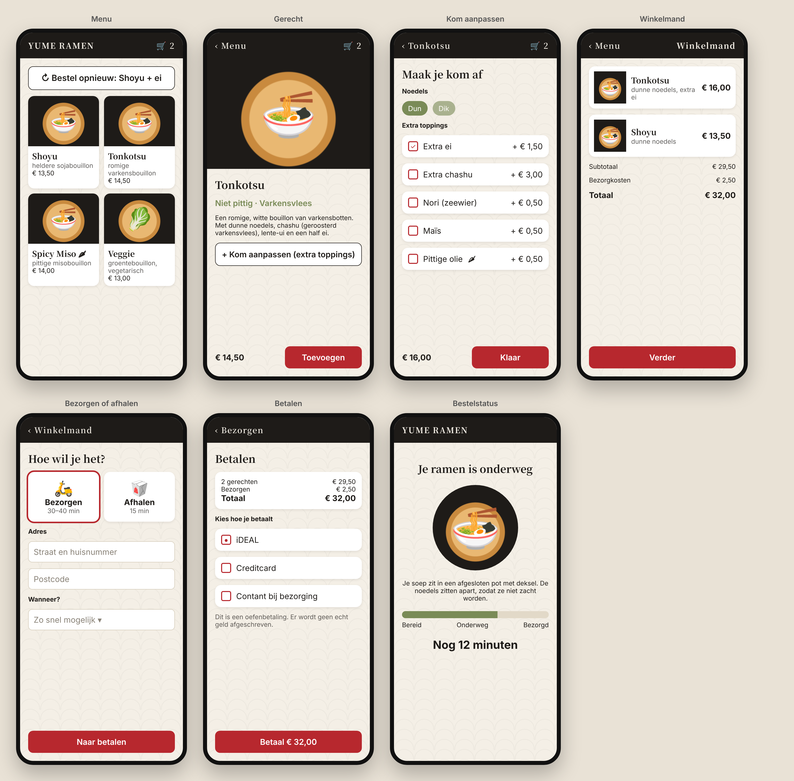
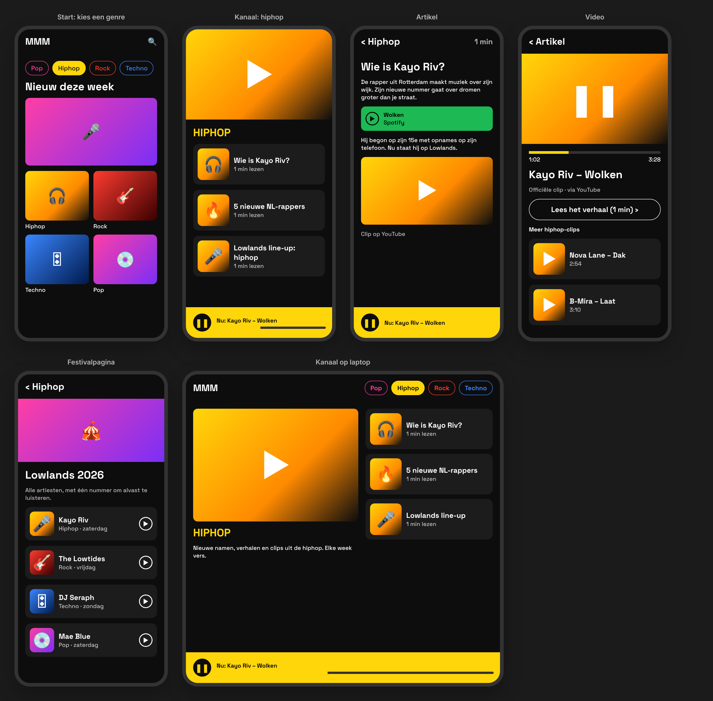
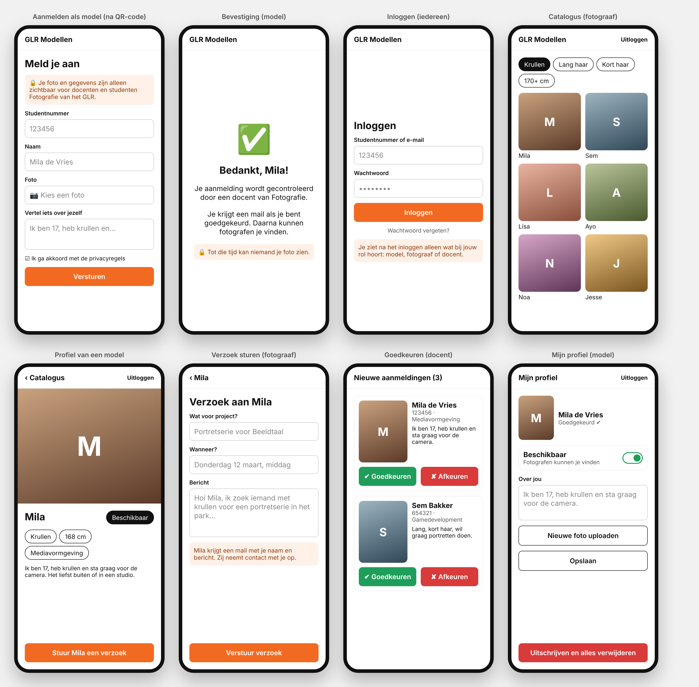
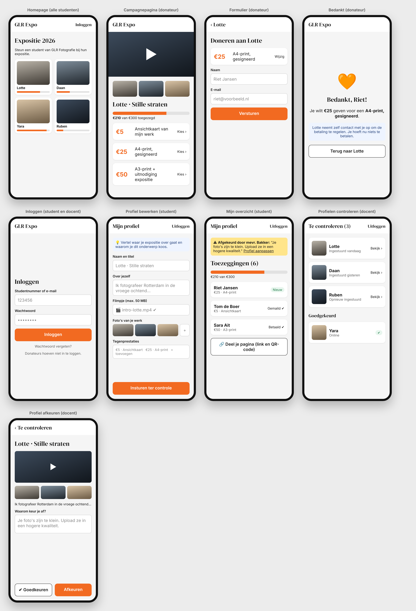

<!-- frontmatter
title: "Kickoff module 2: kies je project"
cohort: "2026-2027"
leerjaar: 2
periode: 2
auteur: "Docententeam CSD"
tags: ["Beroeps", "Kickoff", "Projectplan", "Design Handoff", "Mobile-First", "Teamwork", "Beoordeling"]
-->

<!-- .slide: class="bleed dark" data-background-color="#111111" -->

Beroeps 2 · Module 2 · Kickoff

<h1 class="title title--xl" style="color:#fff">Het concept staat. Jullie maken het waar.</h1>

Vier opdrachtgevers zoeken een team. Vandaag kies je welke.

Beroeps 2 · Kickoff module 201

Note: Welkom bij week 1 van de vernieuwde module Beroeps 2: Mobile-First Design Handoff. Laat studenten bij binnenkomst alvast naast mensen zitten met wie ze willen samenwerken, met laptop open. Vandaag kiezen ze een project, melden ze zich aan bij de opdrachtgever en verdelen ze de rollen. Tijd: 00:00–00:03.

---

Waarom deze module anders is

## In de praktijk krijg je een ontwerp aangeleverd en maak je het technisch waar

  

    
Wat was
Zelf een concept bedenken en een projectplan schrijven. Een groot deel van de 8 weken ging op aan het idee.

  

  

    
Wat kan zijn
Je krijgt een <strong>UX-to-Dev handoff</strong>: onderzoek, eisen en een klikbaar prototype. Jij bouwt het echt.

  

Beroeps 2 · Kickoff module 202

Note: Gagné 1, aandacht trekken (sparkline: wat is, wat kan zijn). Vraag: wat kostte vorig blok de meeste tijd, het bedenken of het bouwen? Leg uit dat een junior developer in de praktijk zelden een leeg vel krijgt, maar een ontwerp waarbinnen hij of zij technisch moet realiseren. Daarom is het projectplan (gebruikersonderzoek, MoSCoW-eisen, flows, prototype) jullie startpunt. Tijd: 00:03–00:07.

---

Leerdoelen

## Aan het einde van deze les kun je …

1. vier projectplannen vergelijken op **spoor** en **Must-eisen**;
2. als team een **onderbouwde keuze** maken;
3. je groepje professioneel aanmelden bij een opdrachtgever;
4. de vier **hoedersrollen** verdelen en uitleggen wat je rol inhoudt.

Beroeps 2 · Kickoff module 203

Note: Gagné 2, doelen communiceren. Doel 1 en 2 horen bij het kijken naar de projecten en de keuze, doel 3 bij de mail, doel 4 bij het werkblok aan het eind. Wat ze niet hoeven: vandaag nog niets bouwen. Tijd: 00:07–00:09.

---

Lesprogramma · 2 lesuren

## Aan het einde van de les is je team gekozen, aangemeld en verdeeld

  
01
<h3>Uitleg &amp; de vier projecten</h3>
Wat levert de module op, wat vraagt elke opdrachtgever?

  
02
<h3>Groepjes maken &amp; kiezen</h3>
Teams van 3 of 4 kiezen samen één plan.

  
03
<h3>Aanmelden bij de opdrachtgever</h3>
Eén mail aan loos@glr.nl, vóór het einde van de les.

  
04
<h3>Rollen verdelen &amp; plan lezen</h3>
Hoedersrollen verdelen en het plan doorlezen.

Beroeps 2 · Kickoff module 204

Note: Gagné 3, voorkennis en overzicht. Loop de vier blokken kort langs. Benadruk dat de mail vóór het einde van de les verstuurd moet zijn: wie niet gekozen heeft, kan niet beginnen met week 1. Tijd: 00:09–00:11.

---

De route · 8 weken, 3 deelopleveringen

## Je levert drie keer op: in week 2, week 5 en week 8

  
DO1
<h3>Einde week 2 · Kickstart &amp; architectuur</h3>
Starter-repo, Testronde 1, technisch ontwerp en een gevulde backlog.

  
DO2
<h3>Einde week 5 · Mobile MVP live</h3>
Alle Must-eisen werken end-to-end op mobiel, live op de GLR Plesk-server.

  
DO3
<h3>Week 8 · Einddemo &amp; code walkthrough</h3>
Volledige app live, Testronde 2 en een individueel codegesprek.

Beroeps 2 · Kickoff module 205

Note: Gagné 4, de route in beeld. Dit zijn vaste kwaliteitsmomenten tegen uitstelgedrag aan het eind. Bij DO2 wordt per student gekeken naar commits en code reviews. Bij DO3 licht elke student 5 tot 10 minuten de eigen front-end en back-end PR's toe. De volledige studentwijzer staat in de starter-template (docs/studentwijzer.md). Tijd: 00:11–00:14.

---

Het projectplan · jullie handoff

## Het onderzoek en de eisen zijn gedaan; jullie starten bij testen en technisch ontwerp

  

    

      
I
<h3>Inzichten</h3>
Wat weten we over de gebruiker?

      
E
<h3>Eisen (MoSCoW)</h3>
Must, Should, Could, Won't.

      
T
<h3>Testen</h3>
Jullie testen en vullen aan.

    

  

  

    
Waar staan ze?
github.com/<strong>baasglr/projectplannen</strong>: per project een map met <code>README.md</code> en schermontwerpen.

  

Beroeps 2 · Kickoff module 206

Note: Elk plan heeft dezelfde opbouw met codes: I voor inzichten, E voor eisen, T voor tests. In week 1 zetten jullie die E-codes om naar GitHub Issues. Afwijken van het plan mag, maar alleen als je dat vooraf pitcht, het wordt goedgekeurd en je het vastlegt in docs/technisch-ontwerp.md. Tijd: 00:14–00:17.

---

Tech stack · voor alle teams gelijk

## Alle teams bouwen met dezelfde stack, van 375px HTML tot PHP op Plesk

  
Front-end<h3>Mobile-First</h3>
Semantische HTML5, CSS vanaf 375px en Vanilla JavaScript.

  
Back-end &amp; data<h3>PHP + MySQL</h3>
PHP 8 met PDO en MySQL, lokaal via DBngin.

  
Workflow<h3>GitHub → Plesk</h3>
Pull Requests, CODEOWNERS en CI, daarna live op Plesk.

Beroeps 2 · Kickoff module 207

Note: Het kernpunt: iedereen werkt in dezelfde techniek, dus verschillen zitten in het project, niet in de tooling. React komt pas in de volgende periode. Lokaal ontwikkelen kan op de GLR-iMacs en eigen laptops met bash scripts/dev.sh. Tijd: 00:17–00:20.

---

Project 1 · Yume Ramen

## Yume Ramen wil dat je in vijf tikken ramen bestelt, mét Japanse sfeer

  

    <figure class="fig-fill">
      
    </figure>
  

  

    
Basisspoor · Mobile UX, snelheid en bestelflow

    <ul class="check">
      <li class="fragment">Een bezorgapp voor ramenfans én nieuwe klanten.</li>
      <li class="fragment">Menu met uitleg per gerecht, mand en bestelstatus.</li>
      <li class="fragment">Sfeer in kleur, beeld en letters.</li>
    </ul>
  

Beroeps 2 · Kickoff module 208

Note: Gagné 4. Opdrachtgever: Yume Ramen. Plan: yume-ramen/README.md. Dit is het basisspoor: de focus ligt op mobiele UX, snelheid en de bestelflow. Goed voor teams die eerst een stevige basis willen neerzetten. Laat bij de eisen E1 tot E4 (foto en uitleg per gerecht, maximaal 5 tikken, zonder installeren, Japanse sfeer) kort zien. Tijd: 00:20–00:23.

---

Project 2 · Music Magnet Magazine

## MMM laat jongeren lezen, luisteren en kijken op één scherm

  

    <figure class="fig-fill">
      
    </figure>
  

  

    
Middelspoor · Dynamische DOM, media en API

    <ul class="check">
      <li class="fragment">Website en app voor jongeren van 14 tot 25 jaar.</li>
      <li class="fragment">Per genre komen tekst, muziek en video samen.</li>
      <li class="fragment">Een mini-speler die blijft spelen terwijl je verder leest.</li>
    </ul>
  

Beroeps 2 · Kickoff module 209

Note: Opdrachtgever: MMM. Plan: music-magnet-magazine/README.md. Het middelspoor: de focus ligt op dynamische DOM, media en API-gebruik. Goed voor teams die graag met JavaScript en embeds werken. Muziek en video komen van Spotify en YouTube. Tijd: 00:23–00:26.

---

Project 3 · GLR Modellenbureau

## Het Modellenbureau draait om wie wat mag zien: drie rollen, één veilige site

  

    <figure class="fig-fill">
      
    </figure>
  

  

    
Uitdagend spoor · Full-stack CRUD, rollen en security

    <ul class="check">
      <li class="fragment">Studenten melden zich aan als model via een QR-code.</li>
      <li class="fragment">Een docent keurt aanmeldingen goed.</li>
      <li class="fragment">Alleen ingelogde fotografen en docenten zien de modellen.</li>
    </ul>
  

Beroeps 2 · Kickoff module 210

Note: Opdrachtgever: GLR Fotografie. Plan: modellenbureau/README.md. Uitdagend spoor: full-stack CRUD met drie rollen (model, fotograaf, docent), privacy en security. Foto's en gegevens zijn privacygevoelig, dus de rechten per gebruiker moeten kloppen. Geschikt voor teams die willen groeien in back-end en beveiliging. Tijd: 00:26–00:29.

---

Project 4 · GLR Crowdfunding

## Bij Crowdfunding overtuigt een student donateurs met werk en tegenprestaties

  

    <figure class="fig-fill">
      
    </figure>
  

  

    
Uitdagend spoor · Full-stack CRUD, keuring en formulieren

    <ul class="check">
      <li class="fragment">Een profiel met foto's, filmpje en tegenprestaties per student.</li>
      <li class="fragment">Donateurs geven zich op via een kort formulier.</li>
      <li class="fragment">Een docent keurt een profiel af, met uitleg.</li>
    </ul>
  

Beroeps 2 · Kickoff module 211

Note: Opdrachtgever: GLR Fotografie. Plan: crowdfunding/README.md. Uitdagend spoor: full-stack CRUD, een keuringsflow en formulieren. De student regelt de betaling zelf met de donateur, dus betalen via de site is geen eis. Tijd: 00:29–00:32.

---

Kiezen · drie sporen

## Kies op ambitie: een basisspoor, een middelspoor of twee uitdagende sporen

  
Basis<h3>Yume Ramen</h3>
Mobile UX, snelheid en bestelflow.

  
Midden<h3>Music Magnet Magazine</h3>
Dynamische DOM, media en API.

  
Uitdagend<h3>Modellenbureau &amp; Crowdfunding</h3>
Full-stack CRUD, rollen, keuring en security.

Beroeps 2 · Kickoff module 212

Note: Doe een snelle stemronde: welk spoor trekt je? Hand omhoog per spoor. Geen goed of fout: het verschil in niveau is bewust, zodat teams kunnen kiezen op ambitie. Alle vier projecten krijgen wel een volwaardige full-stack basis (PHP en MySQL). Meerdere groepjes mogen hetzelfde project kiezen. Tijd: 00:32–00:35.

---

Begripscheck · Denk, stem, overleg

## Welk project past bij een team dat drie rollen en privacy wil leren regelen?

  
A<h3>Yume Ramen</h3>
Nee: dit project draait om bestelflow en snelheid.

  
B<h3>Modellenbureau</h3>
Ja: drie rollen met eigen rechten en privacygevoelige gegevens.

  
C<h3>Music Magnet Magazine</h3>
Nee: dit project draait om media en een API.

Beroeps 2 · Kickoff module 213

Note: Gagné 6, prestatie uitlokken (Peer Instruction). Stap 1: iedereen kiest stil. Stap 2: overleg met je buurman of buurvrouw als je antwoorden verschillen. Stap 3: onthul antwoord B. Kanttekening: Crowdfunding heeft ook rollen en een keuringsflow; het kan ook een goede keuze zijn, maar de vraag benadrukt privacy en drie rollen. Tijd: 00:35–00:39.

---

Rollen · T-shaped team

## Iedereen bouwt alles, maar elke rol bewaakt één onderdeel

  
Lead<h3>Product &amp; Backlog</h3>
Bewaakt issues en E-codes.

  
Lead<h3>UX &amp; Mobile CSS</h3>
Bewaakt 375px en huisstijl.

  
Lead<h3>Backend &amp; Data</h3>
Bewaakt database en PHP.

  
Lead<h3>Git, QA &amp; Deployment</h3>
Bewaakt PR's, CI en Plesk.

<h3>"Dat was niet mijn rol" telt niet</h3>
Iedereen pakt aantoonbaar front-end én back-end op, dient PR's in en reviewt code van groepsgenoten.

Beroeps 2 · Kickoff module 214

Note: Een rol betekent eindverantwoordelijkheid voor het bewaken van een onderdeel, niet dat jij het alleen doet. Bij een team van 3 kan een rol gecombineerd worden. Laat studenten alvast nadenken welke rol ze zouden willen, de verdeling volgt straks in het werkblok. Tijd: 00:39–00:43.

---

Beoordeling · Matig, Voldoende, Goed

## Je team wordt beoordeeld, maar criterium 5 beoordeelt jou alleen

  

    

      
1
<h3>Backlog &amp; technisch ontwerp</h3>

      
2
<h3>Mobile-First realisatie &amp; UX</h3>

      
3
<h3>Full-stack code, data &amp; deployment</h3>

      
4
<h3>Gebruikerstesten &amp; Git/CI</h3>

      
5
<h3>Individuele codevaardigheid</h3>

    

  

  

    

<h3>Poortwachter</h3>
Voor <strong>Voldoende</strong> mag criterium 5 nooit <em>Matig</em> zijn, en maximaal één van de criteria 1 t/m 4.

  

Beroeps 2 · Kickoff module 215

Note: Er zijn geen cijfers. Criteria 1 tot 4 gaan over de gezamenlijke deelopleveringen, criterium 5 over jouw eigen bijdrage en kan het eindoordeel per student verhogen of verlagen. De volledige rubric staat in docs/studentwijzer.md in de starter-template. Vraag of studenten vragen hebben. Tijd: 00:43–00:48.

---

## Maak een groepje van drie of vier

  

    
Opdracht 1<h3>Vorm je team</h3>
Gemiddeld 3, maximaal 4 studenten. Kies mensen met wie je echt wilt samenwerken. Kom je er niet uit, geef dan een seintje aan de docent.

  

  

    

      

        <svg viewBox="0 0 120 120" aria-hidden="true">
          <circle class="t-track" cx="60" cy="60" r="54"></circle>
          <circle class="t-prog" cx="60" cy="60" r="54"></circle>
        </svg>
        
05:00Groepjes

      

      
<button class="t-btn t-start" type="button">Start</button><button class="t-btn t-reset" type="button">Reset</button>

    

  

Beroeps 2 · Kickoff module 216

Note: Gagné 6. Laat studenten opstaan en groepjes vormen. Loop rond en help studenten zonder groepje. Teams van 4 zijn het maximum. Tijd: 00:48–00:53.

---

## Lees de plannen en kies samen één project

  

    
Opdracht 2<h3>Lees en kies</h3>
Open <strong>github.com/baasglr/projectplannen</strong>. Lees per project de debriefing en de Must-eisen en kies samen één project.

    <ul class="check">
      <li>Welk spoor past bij onze ambitie?</li>
      <li>Welke Must-eisen durven we aan?</li>
      <li>Wat willen we in deze module leren?</li>
    </ul>
  

  

    

      

        <svg viewBox="0 0 120 120" aria-hidden="true">
          <circle class="t-track" cx="60" cy="60" r="54"></circle>
          <circle class="t-prog" cx="60" cy="60" r="54"></circle>
        </svg>
        
20:00Kiezen

      

      
<button class="t-btn t-start" type="button">Start</button><button class="t-btn t-reset" type="button">Reset</button>

    

  

Beroeps 2 · Kickoff module 217

Note: Gagné 6. Teams lezen minstens de debriefing en de MoSCoW-tabel van meer dan één plan voordat ze kiezen. Meerdere groepjes mogen hetzelfde project kiezen. Loop rond, stel vragen als: welke Must-eis lijkt jullie het lastigst? Tijd: 00:53–01:13.

---

Aanmelden · professioneel mailen

## Meld je groepje aan met één duidelijke mail aan loos@glr.nl

  

    

      
Nieuwe mail

      <pre><code>Aan: loos@glr.nl
Onderwerp: Aanmelding &lt;project&gt; – &lt;klas&gt;

Gekozen project: &lt;project&gt;
Team:
- &lt;naam&gt; (&lt;studentnr&gt;, GitHub: &lt;gebruikersnaam&gt;)
- &lt;naam&gt; (&lt;studentnr&gt;, GitHub: &lt;gebruikersnaam&gt;)
- &lt;naam&gt; (&lt;studentnr&gt;, GitHub: &lt;gebruikersnaam&gt;)
Waarom dit project: &lt;één zin&gt;</code></pre>
    

  

  

    

<h3>Deadline: einde van de les</h3>
Eén mail per team. Je GitHub-gebruikersnaam heb je nodig voor CODEOWNERS.

  

Beroeps 2 · Kickoff module 218

Note: Gagné 6, transfer naar de praktijk: zo meld je je aan bij een opdrachtgever. Eén mail per team, alle namen met studentnummers erin. Spreek af wie verstuurt en dat de anderen in de cc staan. De mail gaat naar de opdrachtgever (loos@glr.nl). Tijd: 01:13–01:18.

---

Werkblok · rollen en plan

## Verdeel de rollen en lees samen het plan; wie klaar is, zet de repo op

  

    
Opdracht 3<h3>Rollen &amp; plan</h3>
Verdeel de vier hoedersrollen en lees samen hoofdstuk 1 t/m 5 van je gekozen plan.

    

      
01
<h3>Klaar? Maak je repo</h3>
Kies <em>Use this template</em> bij <strong>GLR-CSD/beroeps2-module2-starter-template</strong>.

      
02
<h3>Zet je plan erin</h3>
Kopieer de map van je project naar <code>docs/projectplan/</code>.

    

  

  

    

      

        <svg viewBox="0 0 120 120" aria-hidden="true">
          <circle class="t-track" cx="60" cy="60" r="54"></circle>
          <circle class="t-prog" cx="60" cy="60" r="54"></circle>
        </svg>
        
15:00Werkblok

      

      
<button class="t-btn t-start" type="button">Start</button><button class="t-btn t-reset" type="button">Reset</button>

    

  

Beroeps 2 · Kickoff module 219

Note: Gagné 6 en 9 (transfer). Eerst rollen verdelen en het plan doorlezen: dat is de verwachting voor vandaag. Teams die klaar zijn en de mail hebben verstuurd, mogen alvast hun repository maken vanuit de template (één repo per team) en het gekozen plan in docs/projectplan/ zetten. De rest van de inrichting (CODEOWNERS, branch protection, backlog) volgt in week 1 en 2. Tijd: 01:18–01:35.

---

Afsluiting

## Aan het einde van de les weet je team wat het bouwt en wie waar op let

<ul class="check">
  <li class="fragment">De mail aan loos@glr.nl is verstuurd.</li>
  <li class="fragment">Jullie hebben één project gekozen en de rollen verdeeld.</li>
  <li class="fragment">Volgende les: Testronde 1 met het Figma-prototype. Deeloplevering 1 is einde week 2.</li>
</ul>

Beroeps 2 · Kickoff module 220

Note: Gagné 9, retentie en transfer. Doe een korte fist-to-five: hoe zeker ben je van je keuze? Check of elk team de mail heeft verstuurd voordat ze weggaan. Volgende les: Usability Testing ronde 1 met het Figma-prototype op een telefoon, en inzichten en eisen omzetten naar GitHub Issues. Tijd: 01:35–01:40.
