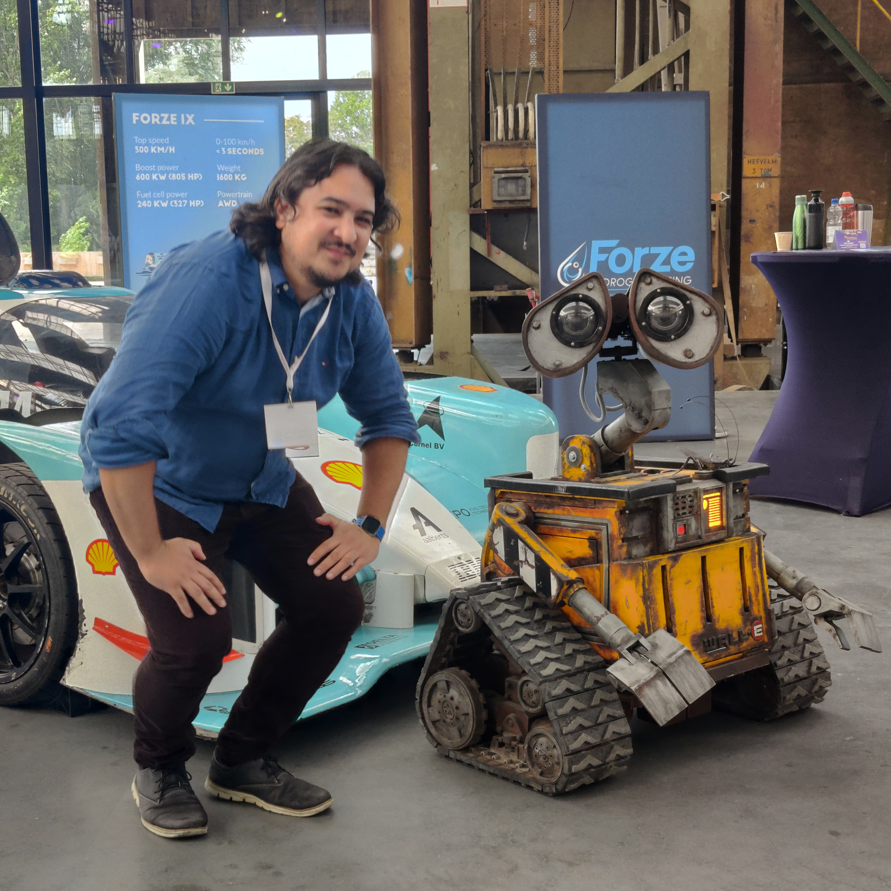

<!-- frontmatter
title: "Dag 1 · The Interactive VJ & Game Lab (p5.js)"
cohort: "2026-2027"
leerjaar: "oriëntatieklas"
periode: 1
auteur: "Dhr. Loos"
tags: ["Oriëntatieklas", "CSD", "p5.js", "Creative Coding", "JavaScript", "Game", "VJ", "Kaleidoscoop", "Vuurwerk", "Aim-Trainer", "DIM", "WHHTUK"]
-->

<!-- .slide: class="dark" data-background-color="#111111" -->

GLR · Creative Software Developer · Oriëntatieklas · Dag 1 · The VJ &amp; Game Lab

<h1 class="title glr-r2" style="color:#fff;font-size:116px;line-height:0.92;margin:22px 0 0">Vandaag ben jij de maker.</h1>

Met p5.js bouw je vandaag een neon-kaleidoscoop, een vuurwerk-engine en je eigen mini-game.

  &gt; start glr-studio --dag1 
  &gt; p5.js geladen ✓ 
  &gt; neon · vuurwerk · game ✓ 
  &gt; wachten op jou ▊

  Nu: <strong style="color:#A6E22E">reader</strong> open — tab 01
  <strong style="color:#A6E22E">editor.p5js.org</strong> open
  telefoon <strong style="color:#A6E22E">weg</strong>

CSD Oriëntatieklas · Dag 1 · p5.js01

Note: Laat deze slide staan terwijl studenten binnenkomen; de animatie speelt vanzelf en blijft pulseren. Praat kort door het 'terminal'-blok heen als visuele hook: vandaag geen theorie-college, maar zelf aan de knoppen. Controleer dat iedereen de reader (tab 01) en de p5.js-editor open heeft en de telefoon weg is. Oriëntatieklas van 2 uur (120 min, geen pauze): laagdrempelig en speels, en strak op de klok.

---

  

    <figure class="img-auto"></figure>
  

  

    
Even voorstellen

    <h2 class="title" style="font-size:80px;line-height:1;margin:12px 0 18px">Dhr. Loos</h2>
    
Docent <strong>Creative Software Developer</strong>

    
Grafisch Lyceum Rotterdam · deze week laat ik je zien dat code net zo creatief is als een penseel.

  

CSD Oriëntatieklas · Dag 1 · p5.js

Note: Stel jezelf in ±1 minuut voor. Zet een (pas)foto of ander plaatje in het fotovlak links en vervang de tekst met je eigen gegevens (voornaam, rol, een kort persoonlijk feitje). Houd het beknopt.

---

Vooruitblik · wat je deze week allemaal kunt gaan maken

<h2 class="title title--md">Drie dagen, drie manieren om te maken</h2>

  

    <svg width="176" height="104" viewBox="0 0 176 104" xmlns="http://www.w3.org/2000/svg" role="img" aria-label="p5.js neon-tekening">
      <rect width="176" height="104" fill="#0D0E12"/>
      <path d="M10 96 C 30 40 55 20 88 50" fill="none" stroke="#A6E22E" stroke-width="2.5"/>
      <path d="M10 46 C 35 78 70 84 92 48" fill="none" stroke="#FF0055" stroke-width="2.5"/>
      <path d="M118 18 C 130 52 150 62 166 34" fill="none" stroke="#00AAFF" stroke-width="2.5"/>
      <circle cx="140" cy="82" r="5" fill="#A6E22E"/>
      <circle cx="84" cy="88" r="6" fill="#FFE600"/>
      <circle cx="52" cy="60" r="4" fill="#FF0055"/>
      <circle cx="118" cy="52" r="3" fill="#00AAFF"/>
    </svg>
    <h3 style="margin:10px 0 4px;font-size:18px">Dag 1 · p5.js — 2D</h3>
    
Teken met code: neon-kaleidoscoop, vuurwerk en een eigen game.

    <a href="https://editor.p5js.org/" target="_blank" rel="noopener" style="display:inline-block;margin-top:10px;background:#A6E22E;color:#111;border:2px solid #111;padding:4px 12px;font-weight:700;font-size:13px;text-decoration:none;font-family:'Space Grotesk',sans-serif">Probeer live &rarr;</a>
  

  

    <svg width="176" height="104" viewBox="0 0 176 104" xmlns="http://www.w3.org/2000/svg" role="img" aria-label="A-Frame 3D-wereld">
      <rect width="176" height="104" fill="#0D0E12"/>
      <line x1="0" y1="88" x2="176" y2="88" stroke="#333333" stroke-width="1"/>
      <line x1="0" y1="74" x2="176" y2="74" stroke="#262626" stroke-width="1"/>
      <polygon points="66,42 104,42 104,70 66,70" fill="none" stroke="#A6E22E" stroke-width="2"/>
      <polygon points="66,42 80,32 118,32 104,42" fill="none" stroke="#00AAFF" stroke-width="2"/>
      <line x1="104" y1="42" x2="118" y2="32" stroke="#00AAFF" stroke-width="2"/>
      <line x1="66" y1="70" x2="80" y2="60" stroke="#444444" stroke-width="1.5"/>
      <line x1="104" y1="70" x2="118" y2="60" stroke="#444444" stroke-width="1.5"/>
      <circle cx="30" cy="40" r="3" fill="#FF0055"/>
    </svg>
    <h3 style="margin:10px 0 4px;font-size:18px">Dag 2 · A-Frame + Quest 2 — VR</h3>
    
Bouw een 3D-wereld in de browser en stap er zelf in met de VR-bril.

    <a href="https://aframe.io/" target="_blank" rel="noopener" style="display:inline-block;margin-top:10px;background:#A6E22E;color:#111;border:2px solid #111;padding:4px 12px;font-weight:700;font-size:13px;text-decoration:none;font-family:'Space Grotesk',sans-serif">Probeer live &rarr;</a>
  

  

    <svg width="176" height="104" viewBox="0 0 176 104" xmlns="http://www.w3.org/2000/svg" role="img" aria-label="Micro:bit met draadloze radio">
      <rect width="176" height="104" fill="#0D0E12"/>
      <rect x="46" y="32" width="66" height="40" rx="6" fill="#111522" stroke="#A6E22E" stroke-width="2"/>
      <circle cx="58" cy="44" r="2.4" fill="#A6E22E"/><circle cx="79" cy="44" r="2.4" fill="#A6E22E"/><circle cx="100" cy="44" r="2.4" fill="#FF0055"/>
      <circle cx="58" cy="54" r="2.4" fill="#A6E22E"/><circle cx="79" cy="54" r="2.4" fill="#FF0055"/><circle cx="100" cy="54" r="2.4" fill="#A6E22E"/>
      <circle cx="58" cy="64" r="2.4" fill="#FF0055"/><circle cx="79" cy="64" r="2.4" fill="#A6E22E"/><circle cx="100" cy="64" r="2.4" fill="#A6E22E"/>
      <path d="M120 46 q 10 -16 20 0" fill="none" stroke="#00AAFF" stroke-width="1.6"/>
      <path d="M120 58 q 14 -26 28 0" fill="none" stroke="#00AAFF" stroke-width="1.6" opacity="0.55"/>
      <line x1="50" y1="30" x2="58" y2="30" stroke="#FFFF00" stroke-width="3" stroke-linecap="square"/>
    </svg>
    <h3 style="margin:10px 0 4px;font-size:18px">Dag 3 · Micro:bit — fysiek</h3>
    
Programmeer een echt apparaat en laat twee bits draadloos praten.

    <a href="https://makecode.microbit.org/?lang=nl" target="_blank" rel="noopener" style="display:inline-block;margin-top:10px;background:#A6E22E;color:#111;border:2px solid #111;padding:4px 12px;font-weight:700;font-size:13px;text-decoration:none;font-family:'Space Grotesk',sans-serif">Probeer live &rarr;</a>
  

CSD Oriëntatieklas · Dag 1 · p5.js

Note:
Vooruitblik op de hele week. Laat de drie thumbnails zien; klik hooguit één link live open als er tijd is. Rode draad: vandaag 2D tekenen, morgen 3D/VR, woensdag een fysiek apparaat. Houd het op ±1 min — het is een teaser, geen demo.
---

De module · Creative Software Developer · deze week

<h2 class="title title--md">Aan het einde van deze week kun je …</h2>

  
01
<h3>Met p5.js een interactieve 2D-visual én een mini-game bouwen</h3>
Dag 1 · neon-kaleidoscoop, vuurwerk en je eigen aim-trainer.

  
02
<h3>Met A-Frame een 3D-wereld bouwen en die op een VR-bril testen</h3>
Dag 2 · een eigen scène die je binnenstapt met de Meta Quest 2.

  
03
<h3>Met de Micro:bit een fysiek apparaat programmeren en draadloos koppelen</h3>
Dag 3 · een game én een radio-hack tussen twee echte Micro:bits.

  
04
<h3>Onderbouwd kiezen of Creative Software Developer bij jou past</h3>
Elke dag · via het Studiekeuze-Kompas.

CSD Oriëntatieklas · Dag 1 · p5.js

Note:
Module-leerdoelen voor de hele week. Lees ze voor of laat studenten ze hardop lezen, en koppel elk doel aan de dag. Zo ervaren ze het hele beroepsbeeld van een CSD: van visuele code (Dag 1) via ruimtelijk/XR (Dag 2) naar fysieke hardware (Dag 3), plus de studiekeuze-check via het Kompas. Vier doelen, geen technisch jargon. Houd het op ±1 min.
---

Wat is een Creative Software Developer?

<h2 class="title title--md">Een vormgever maakt het mooi. Jij maakt het levend.</h2>

  

    

      Vormgeven · alleen kijken
      
Een poster, logo of game-karakter ziet er prachtig uit — maar het staat stil.

    

  

  

    

      Creative Software Developer · laten werken
      
Je wekt dat ontwerp met code tot leven: het reageert, beweegt en speelt.

    

  

CSD Oriëntatieklas · Dag 1 · p5.js02

Note: Fase 1/2 DIM — doeloriëntatie. Toon het contrast tussen statisch vormgeven (je kijkt ernaar) en CSD (je speelt ermee). Koppel direct aan de belofte op de hero: vandaag bouw je dingen die reageren. Houd dit kort (±1 min) en laat de klas één voorbeeld noemen van iets 'levends' dat ze door code kennen.

---

Even opwarmen · denk – deel · 2 minuten

Welke app of game opende jij vanochtend?

Vertel je buur: wat was de <strong>Input</strong> (jouw actie), wat deed de <strong>Code</strong> en wat zág je als <strong>Output</strong>?

  <svg width="100%" height="118" viewBox="0 0 780 118" xmlns="http://www.w3.org/2000/svg" role="img" aria-label="Pipeline: Input, Code, Output">
    <rect x="8" y="28" width="220" height="60" rx="6" fill="#F4F4F6" stroke="#111111" stroke-width="2"/>
    <text x="118" y="54" text-anchor="middle" font-family="Space Grotesk, sans-serif" font-weight="700" font-size="15" fill="#111111" letter-spacing="1">INPUT</text>
    <text x="118" y="75" text-anchor="middle" font-family="Hanken Grotesk, sans-serif" font-size="13" fill="#555555">jouw muis · je toetsen</text>
    <line x1="234" y1="58" x2="278" y2="58" stroke="#A6E22E" stroke-width="3"/>
    <polygon points="286,58 274,51 274,65" fill="#A6E22E"/>
    <rect x="294" y="28" width="192" height="60" rx="6" fill="#A6E22E" stroke="#111111" stroke-width="2"/>
    <text x="390" y="54" text-anchor="middle" font-family="Space Grotesk, sans-serif" font-weight="700" font-size="15" fill="#111111" letter-spacing="1">CODE</text>
    <text x="390" y="75" text-anchor="middle" font-family="Hanken Grotesk, sans-serif" font-size="13" fill="#111111">p5.js draait</text>
    <line x1="492" y1="58" x2="536" y2="58" stroke="#A6E22E" stroke-width="3"/>
    <polygon points="544,58 532,51 532,65" fill="#A6E22E"/>
    <rect x="552" y="28" width="220" height="60" rx="6" fill="#F4F4F6" stroke="#111111" stroke-width="2"/>
    <text x="662" y="54" text-anchor="middle" font-family="Space Grotesk, sans-serif" font-weight="700" font-size="15" fill="#111111" letter-spacing="1">OUTPUT</text>
    <text x="662" y="75" text-anchor="middle" font-family="Hanken Grotesk, sans-serif" font-size="13" fill="#555555">wat je ziet gebeuren</text>
  </svg>

CSD Oriëntatieklas · Dag 1 · p5.js03

Note: Fase 1 DIM — voorkennis activeren. Bewust laagdrempelig: geen 'juiste' voorkennis nodig. Introduceer het Input → Code → Output denken: jouw muis/toets = input, de pagina/game = code, wat je ziet = output. Haal 2 à 3 antwoorden op en benoem telkens de link: 'dat is óók programmeren!' Houd het positief en zonder oordeel.

---

Route · 4 sprints · 120 min

<h2 class="title title--md">Vandaag bouw je drie dingen, in vier sprints</h2>

  
–
<h3>Start</h3>
10 min · kennismaken en opwarmen.

  
1
<h3>Sessie 1.1 · VJ-kaleidoscoop</h3>
35 min · lijnen spiegelen en je eigen penselen via <code>keyPressed</code>.

  
2
<h3>Sessie 1.2 · Vuurwerk &amp; zwaartekracht</h3>
25 min · 60 deeltjes per klik die ontploffen en stuiteren.

  
3
<h3>Sessie 1.3 · Arcade Aim-Trainer</h3>
35 min · een game met score en timer bouwen.

  
4
<h3>Sessie 1.4 · Gallery Walk &amp; afsluiting</h3>
15 min · elkaars game testen en je quests afvinken.

CSD Oriëntatieklas · Dag 1 · p5.js04

Note: Fase 2 DIM — informeer over de opzet. Planning (120 min, geen pauze): start 0:00–0:10 · Sessie 1.1 0:10–0:45 · Sessie 1.2 0:45–1:10 · Sessie 1.3 1:10–1:45 · Sessie 1.4 1:45–2:00. Elke sprint volgt dezelfde fasen (ik doe voor → jij doet met mij → jij doet alleen), maar de instructie is kort: de meeste tijd gaat naar zelf bouwen. Benoem dat Stap A het minimum is en Stap B een bonus als je tijd hebt. Pas kloktijden aan de echte starttijd aan.

---

Sessie 1.1 · kijk mee (ik doe voor)

<h2 class="title title--md">Elke sketch heeft twee helften: <code>setup()</code> en <code>draw()</code></h2>

  

    

      
01
<h3><code>setup()</code> · één keer</h3>
Canvas, kleurmodus en achtergrond — draait één keer bij de start.

      
02
<h3><code>draw()</code> · 60× per seconde</h3>
Hier teken je elk frame opnieuw, dus ook de lijn die je muis volgt.

      
03
<h3><code>line(pmouseX, pmouseY, mouseX, mouseY)</code></h3>
Van je vorige muispositie naar je huidige: zo krijg je een spoor.

    

  

  

    <svg width="300" height="240" viewBox="0 0 300 240" xmlns="http://www.w3.org/2000/svg" role="img" aria-label="setup draait eenmaal, draw herhaalt in een lus">
      <rect x="80" y="18" width="140" height="56" rx="6" fill="#F4F4F6" stroke="#111111" stroke-width="2"/>
      <text x="150" y="43" text-anchor="middle" font-family="Space Grotesk, sans-serif" font-weight="700" font-size="15" fill="#111111">setup()</text>
      <text x="150" y="62" text-anchor="middle" font-family="Hanken Grotesk, sans-serif" font-size="13" fill="#555555">draait 1×</text>
      <line x1="150" y1="74" x2="150" y2="102" stroke="#A6E22E" stroke-width="3"/>
      <polygon points="150,109 143,97 157,97" fill="#A6E22E"/>
      <rect x="80" y="116" width="140" height="56" rx="6" fill="#A6E22E" stroke="#111111" stroke-width="2"/>
      <text x="150" y="141" text-anchor="middle" font-family="Space Grotesk, sans-serif" font-weight="700" font-size="15" fill="#111111">draw()</text>
      <text x="150" y="160" text-anchor="middle" font-family="Hanken Grotesk, sans-serif" font-size="13" fill="#111111">elk frame</text>
      <path d="M 220 156 C 268 156 268 78 224 78" fill="none" stroke="#A6E22E" stroke-width="3"/>
      <polygon points="216,78 229,72 229,84" fill="#A6E22E"/>
      <text x="286" y="126" text-anchor="middle" font-family="Space Grotesk, sans-serif" font-size="13" fill="#555555">60×/s</text>
    </svg>
  

CSD Oriëntatieklas · Dag 1 · p5.js05

Note: Fase 3 DIM — expliciete modelling ('I do'). Demo dit live in editor.p5js.org en denk hardop: "Ik zie line(pmouseX, pmouseY, mouseX, mouseY). mouseX is de horizontale plek van mijn muis. Wil ik rechts ook een gespiegelde lijn, dan trek ik mijn muis af van de schermbreedte: width - mouseX. Ik haal de // ervoor weg en druk op Play om te testen of mijn voorspelling klopt." Maximaal 6-8 min centrale instructie (Sessie 1.1 = 35 min: ±7 min voordoen, ±2 min begripscheck, ±5 min samen, ±20 min zelf).

---

Begripscheck · steek 1, 2 of 3 vingers op

<h2 class="title title--md">Wat gebeurt er als je <code>background()</code> weghaalt uit <code>draw()</code>?</h2>

  
1
<h3>A · Het scherm wordt wit</h3>

  
2
<h3>B · De gekleurde lijnen stapelen op en vullen het scherm</h3>

  
3
<h3>C · De code crasht met een foutmelding</h3>

CSD Oriëntatieklas · Dag 1 · p5.js06

Note: Fase 4 DIM — diagnostische begripscheck (Peer Instruction). Juiste antwoord: B (2 vingers). Zonder background() wordt het scherm nooit leeggeveegd, dus teken je elk frame over het vorige heen. Beslisprotocol: >80% goed → ga door en laat één student het uitleggen; 30-80% → 60 sec tweetallen-overleg + herstemming; <30% → herinstructie: typ background(0) weg en laat de klas de fout live zien voordat je verdergaat.

---

Sessie 1.1 · samen (jij doet met mij)

<h2 class="title title--md">Eerste aanpassing samen: maak het neon na-glowed</h2>

  
01
<h3>Open de reader (tab 01) en kopieer <code>Tier 1</code></h3>
Plak de startcode in <strong>editor.p5js.org</strong> en druk op Play.

  
02
<h3><code>TODO(t1)</code> · verander het vierde getal</h3>
<code>background(0, 0, 0, 25)</code> → <code>background(0, 0, 0, 6)</code>.

Doe dit stap voor stap samen met mij — pas als het bij <strong>iedereen</strong> werkt, ga je alleen verder.

CSD Oriëntatieklas · Dag 1 · p5.js07

Note: Fase 5 DIM — begeleide inoefening ('We do'). Laat de klas letterlijk met je meeklikken: reader openen, Tier 1 kopiëren, en samen TODO(t1) uitvoeren (25 → 6). Leg uit dat het vierde getal de doorzichtigheid is: lager = langer na-licht. Check dat bij iedereen het spoor als neon na-gloeit voordat je de zelfstandige sprint start.

---

Sessie 1.1 · jij alleen · 2-staps makersprint

<h2 class="title title--md">Tier 1 · De Neon Laser Kaleidoscoop</h2>

  

    

      
A
<h3>Stap A · Code-Fix (<code>TODO 2–3</code>)</h3>
Maak de 4-voudige spiegeling af: <code>width - mouseX</code> én <code>height - mouseY</code>.

      
B
<h3>Stap B · Studio Design-Briefing (<code>TODO 4</code>)</h3>
Bouw <code>keyPressed()</code>: toets <code>1</code> dunne laser, <code>2</code> dikke kwast, <code>3</code> cirkels, <code>spatie</code> veegt schoon.

    

    
Klaar? Vink <strong>Quest 1.1</strong> af en laat je buur je sneltoetsen testen.

  

  

    <svg width="290" height="290" viewBox="0 0 290 290" xmlns="http://www.w3.org/2000/svg" role="img" aria-label="Vier spiegels rond je muis">
      <rect x="0" y="0" width="290" height="290" fill="#0D0E12" stroke="#333333" stroke-width="2"/>
      <line x1="145" y1="0" x2="145" y2="290" stroke="#A6E22E" stroke-width="1.2" stroke-dasharray="5 5"/>
      <line x1="0" y1="145" x2="290" y2="145" stroke="#A6E22E" stroke-width="1.2" stroke-dasharray="5 5"/>
      <circle cx="90" cy="90" r="9" fill="#A6E22E"/>
      <text x="90" y="72" text-anchor="middle" font-family="Space Grotesk, sans-serif" font-size="13" fill="#A6E22E">jij</text>
      <circle cx="200" cy="90" r="9" fill="#FF0055"/>
      <text x="200" y="72" text-anchor="middle" font-family="Hanken Grotesk, sans-serif" font-size="11" fill="#FF0055">width - x</text>
      <circle cx="90" cy="200" r="9" fill="#002BFF"/>
      <text x="90" y="232" text-anchor="middle" font-family="Hanken Grotesk, sans-serif" font-size="11" fill="#002BFF">height - y</text>
      <circle cx="200" cy="200" r="9" fill="#FFE600"/>
      <text x="200" y="232" text-anchor="middle" font-family="Hanken Grotesk, sans-serif" font-size="11" fill="#FFE600">beide</text>
    </svg>
  

CSD Oriëntatieklas · Dag 1 · p5.js08

Note: Fase 6 DIM — zelfstandige verwerking. De reader (tab 01) bevat de volledige Tier 1 startcode + uitklapbaar spiekbriefje. Stap A garandeert een snelle succeservaring (iedereen kan de spiegeling afmaken), Stap B daagt snelle studenten uit met keyPressed. Loop rond met didactisch coachen (verdiepende vragen, geen antwoorden voorkauwen). Zelfstandig werken: ±20 min. Rond 0:45 door naar Sessie 1.2, ook als niet iedereen Stap B af heeft.

---

De makersprint · even de spelregels

<h2 class="title title--md">Zo word jij de baas over je code</h2>

  
01
<h3>Eerst repareren, dan jouw draai</h3>
Maak Stap A (Code-Fix) werkend, ga dan door naar Stap B: jouw eigen ontwerp.

  
02
<h3>Samen, op fluistertoon</h3>
Je eigen laptop; overleggen met je tafelpartner mag.

  
03
<h3>Vast? Eerst Boek, dan Buur, dan Baas</h3>
<strong>Boek</strong> = het spiekbriefje in de reader · <strong>Buur</strong> = je duo · <strong>Baas</strong> = ik, de docent.

  
04
<h3>De klok telt</h3>
Eerst Stap A (±8 min), daarna Stap B tot de timer afloopt. Stap B niet af? Geen probleem.

  
05
<h3>Je eindigt met iets échts</h3>
Een werkend prototype dat je meteen aan een tester kunt geven.

  
06
<h3>Top = werkt én is van jou</h3>
Start op zonder foutmeldingen, en jouw eigen keuzes zijn zichtbaar.

CSD Oriëntatieklas · Dag 1 · p5.js09

Note: Fase 6 DIM — dit kader bespreek je één keer uitgebreid bij Sessie 1.1 (±1 min); bij 1.2 en 1.3 verwijs je er alleen kort naar. Benadruk de 3B-regel: bij een rode foutmelding eerst Boek/Browser (spiekbriefje of 'Kopieer code'), dan 30 sec je Buur, dan pas je hand opsteken (Baas). Dit bouwt zelfredzaamheid op.

---

Sessie 1.2 · particle-fysica

<h2 class="title title--md">Tier 2 · Vuurwerk, zwaartekracht &amp; stuiteren</h2>

  
A
<h3>Stap A · Code-Fix (<code>TODO 1–3</code>)</h3>
Zwaartekracht <code>p.vy += 0.22</code> en een explosie van <code>60</code> deeltjes per muisklik.

  
B
<h3>Stap B · Design-Briefing (<code>TODO 4</code>)</h3>
Vloer-stuiter: <code>p.y &gt; height - 10</code> → <code>p.vy *= -0.78</code>.

Zwaartekracht + stuiter = het kernidee achter elk spel: <strong>beweging + krachten</strong>.

CSD Oriëntatieklas · Dag 1 · p5.js10

Note: Fase 3/6 DIM — Sessie 1.2 = 25 min: max 3 min modelling van zwaartekracht (elke frame een beetje snelheid naar beneden, precies hoe een bal valt), dan ±22 min zelfstandig. De vloer-stuiter (p.y > height - 10 met p.vy *= -0.78) is het conceptuele hoogtepunt: laat snelle studenten zelf de stuiterfactor ontdekken. Vink Quest 1.2 af in de reader.

---

Sessie 1.3 · jij alleen

<h2 class="title title--md">Tier 3 · Aim-Trainer met 30-seconden timer</h2>

  
A
<h3>Stap A · Code-Fix (<code>TODO 1–3</code>)</h3>
Klikbaar doelwit via <code>dist(mouseX, mouseY, doelX, doelY)</code> + live score.

  
B
<h3>Stap B · Design-Briefing (<code>TODO 4</code>)</h3>
30s countdown (<code>frameCount % 60</code>) én een krimpend doelwit: <code>doelStraal *= 0.94</code>. Herstart met <code>R</code>.

Test je game goed — straks laat je hem aan <strong>twee</strong> klasgenoten zien.

CSD Oriëntatieklas · Dag 1 · p5.js11

Note: Fase 6 DIM — Sessie 1.3 = 35 min: ±3 min uitleg, ±32 min zelfstandig met WHHTUK + 3B. De timer + krimpend doelwit is de Stap B-uitdaging; de volledige code staat in het spiekbriefje onder Tier 3 in de reader. Differentieer: wie alles af heeft, mag kaleidoscoop + vuurwerk uitbouwen tot een eigen VJ-deck. Vink Quest 1.3 af. Stop om 1:45 voor de Gallery Walk.

---

Sessie 1.4 · Arcade Gallery Walk

<h2 class="title title--md">Laat je game testen door twee klasgenoten</h2>

  
01
<h3>Vertel kort wat je hebt gebouwd</h3>
Wat werkt er en wat heb je zelf toegevoegd?

  
02
<h3>Laat twee testers spelen</h3>
Ze noteren: speelt het, en wat kan beter?

  
03
<h3>Geef terug: één compliment + één tip</h3>
Bij elke game die jij test: één progressie + één discrepantie.

CSD Oriëntatieklas · Dag 1 · p5.js12

Note: Fase 7 DIM — evaluatie + kerntaak P4-K1 (testen). ±10 min. Laat de klas opstaan en langs 2 schermen lopen (±4 min per scherm). Elke tester geeft één compliment (progressie) en één verbeterpunt (discrepantie). Haal daarna 1 mooie vondst klassikaal naar voren.

---

Check · vink je quests af · OVG

<h2 class="title title--md">Wat heb jij vandaag laten werken?</h2>
<ul class="check">
  <li><strong>Quest 1.1</strong> — kaleidoscoop met 4-voudige spiegeling + eigen penselen (toets 1/2/3/spatie).</li>
  <li><strong>Quest 1.2</strong> — 60 deeltjes per klik met zwaartekracht én vloer-stuiter.</li>
  <li><strong>Quest 1.3</strong> — aim-trainer met timer én krimpend doelwit, getest in de Gallery Walk.</li>
</ul>

<strong>Voldoende</strong> = Stap A overal af · <strong>Goed</strong> = ook Stap B (jouw eigen ontwerpkeuzes) werkt. Nog niet af? Geen stress — in twee uur is dat heel normaal.

CSD Oriëntatieklas · Dag 1 · p5.js13

Note: Fase 7 DIM + formatieve OVG-check. Laat studenten zelf hun voortgang afvinken in de reader. Valschema: Onvoldoende = code start niet / geen eigen aanpassingen; Voldoende = Stap A (Code-Fix) werkend; Goed = Stap A + Stap B (Design-Briefing) zichtbaar. Dit is géén cijfer, maar bewijs van eigen kunnen. Peil met een snelle handopsteek-ronde wie welke tier haalde (±2 min).

---

Wat neem je mee · en wat komt er morgen?

<h2 class="title title--md">Code is een penseel. Jij bent de maker.</h2>

  
01
<h3>Developers remixen werkende code</h3>
Verander een getal, zie direct resultaat — dat is de hele truc.

  
02
<h3>Vul je Studiekeuze-Kompas in</h3>
Open tab 04 in de reader en vink aan waar jij energie van kreeg.

  
03
<h3>Morgen · Dag 2 · stap een wereld binnen</h3>
Bouw een 3D-wereld met A-Frame en wandel er zelf doorheen met de Meta Quest 2.

CSD Oriëntatieklas · Dag 1 · p5.js14

Note: Fase 7 DIM — terugblik + transfer (±3 min). Vat samen, laat studenten het Studiekeuze-Kompas invullen en geef een teaser voor Dag 2 (WebVR + Quest 2). Sluit af: dit was écht programmeren — en jullie hebben het zojuist zelf gedaan. Morgen voegen we de derde dimensie toe.
