<!-- frontmatter
title: "Dag 3 · Developer Hacker Lab & Micro:bit Studio"
cohort: "2026-2027"
leerjaar: "oriëntatieklas"
periode: 1
auteur: "Dhr. Loos"
tags: ["Oriëntatieklas", "CSD", "Developer Mindset", "Inspecteren", "Bug-Bounty", "Testen", "Micro:bit", "MakeCode", "Radio", "DIM"]
-->

<!-- .slide: class="dark" data-background-color="#111111" -->

<style>
@keyframes glr-glow { 0%,100% { text-shadow:0 0 16px rgba(166,226,46,.45),0 0 32px rgba(166,226,46,.25); } 50% { text-shadow:0 0 28px rgba(166,226,46,.9),0 0 64px rgba(166,226,46,.55),0 0 90px rgba(166,226,46,.35); } }
.glr-glow { animation:glr-glow 2.4s ease-in-out infinite; }
@keyframes glr-blink { 0%,49% { opacity:1; } 50%,100% { opacity:0; } }
.glr-cursor { animation:glr-blink 1s steps(1) infinite; }
@keyframes glr-up { from { opacity:0; transform:translateY(28px); } to { opacity:1; transform:translateY(0); } }
@keyframes glr-in { from { opacity:0; } to { opacity:1; } }
@keyframes glr-pop { 0% { opacity:0; transform:scale(.72); } 60% { opacity:1; transform:scale(1.05); } 100% { transform:scale(1); } }
.glr-r1 { animation:glr-up .6s ease-out .15s both; }
.glr-r2 { animation:glr-up .6s ease-out .4s both; }
.glr-maker { animation:glr-pop .65s cubic-bezier(.16,.84,.28,1) .72s both, glr-glow 2.4s ease-in-out 1.5s infinite; }
.glr-r3 { animation:glr-up .6s ease-out 1.05s both; }
.glr-r4 { animation:glr-in .7s ease-out 1.4s both; }
.glr-r5 { animation:glr-up .6s ease-out 1.75s both; }
.d3-shot { display:block;width:auto;max-width:100%;height:auto;max-height:390px;border:2px solid #111;border-radius:6px; }
.d3-thumb { display:block;width:100%;height:118px;object-fit:contain;background:#fff;border-radius:6px;margin-bottom:12px; }
.d3-cap { font-size:15px;color:#555;margin-top:8px;line-height:1.3; }
.d3-block { display:inline-block;background:#E3008C;color:#fff;font-family:'Space Grotesk',sans-serif;font-weight:700;font-size:19px;padding:6px 12px;border-radius:6px; }
</style>

<div class="bar bar--thin glr-r1" style="margin-top:34px;background:#A6E22E"></div>
<p class="kicker kicker--lime glr-r1" style="letter-spacing:0.16em">GLR · Creative Software Developer · Oriëntatieklas · Dag 3 · Hacker Lab &amp; Micro:bit</p>
<h1 class="title glr-r2" style="color:#fff;font-size:108px;line-height:0.92;margin:22px 0 0">Vandaag kraak je<br><span class="glr-maker" style="color:#A6E22E;text-shadow:0 0 30px rgba(166,226,46,0.6)">het systeem.</span></h1>
<p class="lede glr-r3" style="color:#EDEDED;font-size:28px;max-width:900px;margin-top:24px">Je opent een kluis met de broncode, jaagt op bugs voor € 4.000,- en laat na de lunch twee micro:bits draadloos met elkaar praten.</p>
<div class="glr-r4" style="background:#0D0E12;border:2px solid #333;padding:16px 22px;max-width:780px;margin:18px auto 0;text-align:left;font-family:Consolas,Monaco,monospace;font-size:18px;line-height:1.6">
  <span style="color:#A6E22E">&gt;</span> <span style="color:#fff">start glr-hackerlab --dag3</span><br>
  <span style="color:#A6E22E">&gt;</span> <span style="color:#EDEDED">kluis vergrendeld · 5 cijfers</span> <span style="color:#76B800">✓</span><br>
  <span style="color:#A6E22E">&gt;</span> <span style="color:#EDEDED">ticketshop online · 8 bugs verstopt</span> <span style="color:#76B800">✓</span><br>
  <span style="color:#A6E22E">&gt;</span> <span style="color:#A6E22E">wachten op jou</span> <span class="glr-cursor" style="color:#fff">▊</span>
</div>
<div class="glr-r5" style="margin-top:16px;display:flex;gap:12px;flex-wrap:wrap;justify-content:center">
  <span style="border:1px solid #444;color:#EDEDED;padding:6px 14px;font-size:15px">Nu: <strong style="color:#A6E22E">reader</strong> open — tab 03</span>
  <span style="border:1px solid #444;color:#EDEDED;padding:6px 14px;font-size:15px">zoek een <strong style="color:#A6E22E">duo</strong></span>
  <span style="border:1px solid #444;color:#EDEDED;padding:6px 14px;font-size:15px">telefoon <strong style="color:#A6E22E">weg</strong></span>
</div>
<div class="footer"><span>CSD Oriëntatieklas · Dag 3 · Developer Mindset</span></div>

Note: Inloop tot 10:30: laat deze slide staan; de animatie speelt vanzelf. Studenten openen de reader, die start direct op Tab 03 → Deel A (Developer Hacker Lab), en gaan in duo's zitten. Dag van 10:30–15:00 met lunchpauze 12:30–13:00. Docenten-spiekbrief in de reader: Shift + Alt + D (of 5x snel klikken op het groene GLR-logo linksboven). Kluiscode: 73942.

---

<p class="kicker">10:30 · een nieuwe start</p>
<h2 class="title title--md">Een developer is 80% van de tijd niet aan het typen</h2>
<div class="row" style="margin-top:14px">
  <div class="col" style="flex:1 1 50%">
    <div class="defbox" style="min-height:200px">
      <span class="k">Vorige keer</span>
      <p>Veel code typen, en techniek die haperde. Dat is maar een klein stukje van het vak.</p>
    </div>
  </div>
  <div class="col" style="flex:1 1 50%">
    <div class="defbox fragment" style="min-height:200px">
      <span class="k">Vandaag</span>
      <p>Systemen kraken, puzzels oplossen, fouten opsporen en slimme apparaten bouwen.</p>
    </div>
  </div>
</div>
<p class="body fragment" style="margin-top:20px">Vraag aan je duo: <strong>waar kijkt een developer naar als hij een website opent?</strong></p>
<div class="footer"><span>CSD Oriëntatieklas · Dag 3 · Developer Mindset</span><span class="num">01</span></div>

Note: Fase 1 DIM — aandacht trekken en voorkennis activeren (±2 min). Openingstekst uit het lesplan: "Vorige keer liepen we vast omdat we bezig waren met het typen van code en haperende techniek. Maar een echte Creative Software Developer is 80% van de tijd helemaal niet aan het typen. Een developer is iemand die systemen kraakt, puzzels oplost, loopholes vindt en slimme apparaten bouwt." Laat duo's 30 seconden overleggen over de vraag en haal 2 antwoorden op. Brug: een gebruiker ziet de buitenkant, een developer kijkt eronder.

---

<p class="kicker">Leerdoelen · vandaag</p>
<h2 class="title title--md">Aan het einde van vandaag kun je …</h2>
<div class="rows">
  <div class="listrow fragment"><span class="n">01</span><div><h3>In de broncode van een webpagina kijken en er iets in aanpassen</h3><p>Deel A · de HTML Kluis-Kraker.</p></div></div>
  <div class="listrow fragment"><span class="n">02</span><div><h3>Bugs vinden door een systeem expres verkeerd te gebruiken</h3><p>Deel A · de Bug-Bounty Jacht in de Festival Ticketshop.</p></div></div>
  <div class="listrow fragment"><span class="n">03</span><div><h3>Een micro:bit laten reageren op knoppen en schudden</h3><p>Deel B · beginnercursussen en spellen in MakeCode.</p></div></div>
  <div class="listrow fragment"><span class="n">04</span><div><h3>Twee micro:bits draadloos berichten laten sturen</h3><p>Deel B · Micro-Chat en de radiospellen.</p></div></div>
</div>
<div class="footer"><span>CSD Oriëntatieklas · Dag 3 · Developer Mindset</span><span class="num">02</span></div>

Note: Fase 2 DIM — doeloriëntatie (±1 min). Vier doelen, twee voor de lunch en twee erna. Benadruk: alles werkt in de browser op de school-iMacs, je hoeft niets te installeren, en je werkt de hele dag in duo's.

---

<p class="kicker">Route · 10:30–15:00</p>
<h2 class="title title--md">Eerst software kraken, dan hardware bouwen</h2>
<div class="rows rows--tight">
  <div class="listrow"><span class="n">A</span><div><h3>10:30 · De HTML Kluis-Kraker</h3><p>Vind de 5 verborgen cijfers met Inspecteren.</p></div></div>
  <div class="listrow"><span class="n">B</span><div><h3>11:15 · Eerste start met de micro:bit</h3><p>Kennismaken en je eerste code op het bordje.</p></div></div>
  <div class="listrow"><span class="n">A</span><div><h3>11:45 · De € 4.000,- Bug-Bounty Jacht</h3><p>Breek de ticketshop op 8 manieren.</p></div></div>
  <div class="listrow"><span class="n">–</span><div><h3>12:30 · lunchpauze</h3><p>30 min.</p></div></div>
  <div class="listrow"><span class="n">B</span><div><h3>13:00 · Micro:bit Studio verder in 3 stappen</h3><p>Beginnercursussen → spellen → Micro-Chat en radiospellen.</p></div></div>
  <div class="listrow"><span class="n">★</span><div><h3>14:45 · Inleveren en GLR Kompas</h3><p>Einde om 15:00.</p></div></div>
</div>
<div class="footer"><span>CSD Oriëntatieklas · Dag 3 · Developer Mindset</span><span class="num">03</span></div>

Note: Fase 2 DIM — informeer over de opzet (±1 min). Volledige planning: 10:30–11:15 Kluis-Kraker · 11:15–11:45 eerste start micro:bit (leg om 11:10 per duo-tafel een micro:bit + USB-kabel klaar) · 11:45–12:30 Bug-Bounty · 12:30–13:00 lunch (bordjes blijven liggen) · 13:00–13:30 Stap 1 (verder) · 13:30–14:05 Stap 2 · 14:05–14:20 Stap 3A Micro-Chat · 14:20–14:45 Stap 3B radiospellen · 14:45–15:00 inname en Kompas.

---

<p class="kicker">Deel A · kijk mee (ik doe voor) · 10:33</p>
<h2 class="title title--md">Wat je op het scherm ziet is alleen de buitenkant van een website</h2>
<div class="row" style="margin-top:12px;align-items:center">
<div class="col code-sm" style="flex:1 1 62%">

```html [1|2|3-5]
<!-- notitie van de developer: niet vergeten! -->
<button disabled>Alleen voor admins</button>
<div style="background:black">
  Hier staat iets wat jij niet mag zien
</div>
```

</div>
<div class="col" style="flex:1 1 38%">
<div class="defbox"><span class="k">Zo kijk je eronder</span><p><strong>Rechtermuisknop → Inspecteren.</strong> Je ziet de HTML waar de pagina van gemaakt is, en je mag er in je eigen browser alles in aanpassen.</p></div>
</div>
</div>
<div class="footer"><span>CSD Oriëntatieklas · Dag 3 · Developer Mindset</span><span class="num">04</span></div>

Note: Fase 3 DIM — modelling (±3 min). Doe het live voor op een willekeurige website (bijv. een nieuwssite): rechtermuisknop op een kop → Inspecteren → dubbelklik op de tekst en verander de krantenkop. Denk hardop: "Ik zie een knop die grijs is. In de HTML staat het woord disabled. Wat gebeurt er als ik dat weghaal?" Loop met de regel-focus langs de drie trucs: een commentaarregel die je alleen in de broncode ziet, een knop die op slot zit met disabled, en een laag die iets afdekt. Doe het NIET voor op de kluis zelf; dat is hun puzzel.

---

<p class="kicker">Deel A · challenge 1 · in duo's · 10:35–11:15</p>
<h2 class="title title--md">Kraak de kluis: vijf cijfers, vijf verstopplekken</h2>
<div class="row" style="margin-top:8px;align-items:flex-start">
  <div class="col" style="flex:1 1 50%">
    <div class="rows rows--tight">
      <div class="listrow"><span class="n">1</span><div><h3>Een vergeten notitie in de broncode</h3></div></div>
      <div class="listrow"><span class="n">2</span><div><h3>Onzichtbare inkt: wit op wit</h3></div></div>
      <div class="listrow"><span class="n">3</span><div><h3>Een zwart schild dat iets afdekt</h3></div></div>
      <div class="listrow"><span class="n">4</span><div><h3>Een knop die op slot zit</h3></div></div>
      <div class="listrow"><span class="n">5</span><div><h3>Een rekensom in de code</h3></div></div>
    </div>
    <p class="body" style="margin-top:14px;font-size:20px">Gokken heeft geen zin: er zijn 100.000 codes.</p>
  </div>
  <div class="col" style="flex:1 1 50%">
    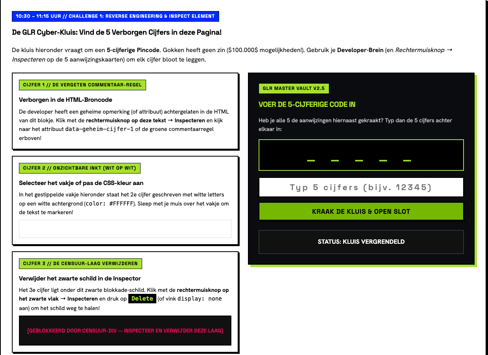
    <p class="d3-cap">Reader · tab 03 · Deel A · de GLR Cyber-Kluis</p>
  </div>
</div>
<div class="footer"><span>CSD Oriëntatieklas · Dag 3 · Developer Mindset</span><span class="num">05</span></div>

Note: Fase 6 DIM — zelfstandig in duo's (±40 min). Oplossing (niet tonen): 73942. Cijfer 1 = 7 (HTML-commentaar of attribuut data-geheim-cijfer-1), cijfer 2 = 3 (witte tekst selecteren met de muis), cijfer 3 = 9 (zwarte div #blackShield in Inspecteren verwijderen met Delete), cijfer 4 = 4 (het woord disabled weghalen bij de knop en klikken), cijfer 5 = 2 (uitkomst van (20 / 4) - 3). Loop rond en geef alleen richting ("op welk blokje heb je al geïnspecteerd?"), geen antwoorden. Vast? Eerst Boek (de aanwijzingskaart), dan Buur, dan Baas. Snelle duo's helpen een ander duo met één hint. Rond 11:05 de begripscheck op de volgende slide.

---

<p class="kicker">Begripscheck · steek 1, 2 of 3 vingers op</p>
<h2 class="title title--md">Je verwijdert het zwarte schild met Inspecteren. Wat ziet je buurman op zíjn scherm?</h2>
<div class="rows rows--tight">
  <div class="listrow"><span class="n">1</span><div><h3>A · Bij hem is het schild nu ook weg</h3></div></div>
  <div class="listrow"><span class="n">2</span><div><h3>B · Bij hem is er niets veranderd</h3></div></div>
  <div class="listrow"><span class="n">3</span><div><h3>C · De website is voor iedereen kapot</h3></div></div>
</div>
<div class="footer"><span>CSD Oriëntatieklas · Dag 3 · Developer Mindset</span><span class="num">06</span></div>

Note: Fase 4 DIM — diagnostische begripscheck (±3 min, rond 11:05). Juist: B (2 vingers). Inspecteren past alleen de kopie van de pagina in jouw eigen browser aan; de echte website op de server blijft gelijk, en na verversen is alles terug. Beslisprotocol: >80% goed → één student laat het uitleggen; 30–80% → 60 sec overleg in duo's + herstemming; <30% → laat een student het schild verwijderen en daarna de pagina verversen. Koppel aan ethiek: kijken in broncode mag altijd, inbreken op andermans systeem niet. Wat we vandaag doen is legaal omdat het onze eigen oefenpagina is.

---

<p class="kicker">Deel B · 11:15 · maak kennis</p>
<h2 class="title title--md">De micro:bit is een complete computer die in je hand past</h2>
<div class="row" style="margin-top:8px;align-items:center">
  <div class="col" style="flex:1 1 44%">
    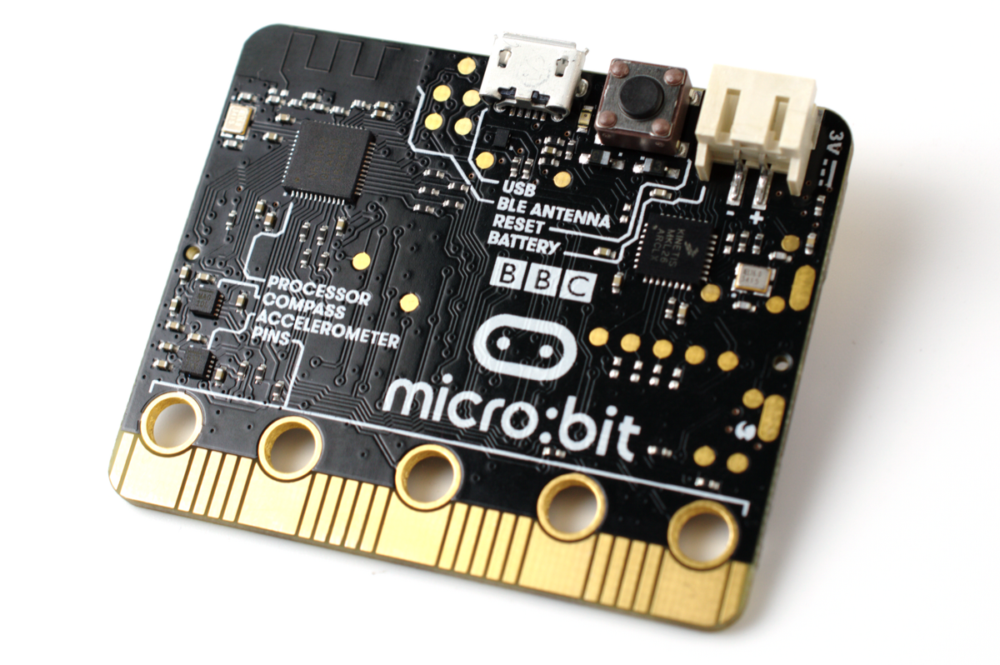
    <p class="d3-cap">Achterkant van de BBC micro:bit · foto: Gareth Halfacree, Wikimedia Commons (CC BY-SA 2.0)</p>
  </div>
  <div class="col" style="flex:1 1 56%">
    <div class="rows rows--tight" style="margin-top:0">
      <div class="listrow"><span class="n">1</span><div><h3>Voorkant: 25 rode LED's</h3><p>Je beeldscherm van 5 bij 5 pixels.</p></div></div>
      <div class="listrow"><span class="n">2</span><div><h3>Voorkant: knop A en knop B</h3><p>Je invoer, net als een muisklik.</p></div></div>
      <div class="listrow"><span class="n">3</span><div><h3>Achterkant: accelerometer</h3><p>Voelt of je schudt of kantelt.</p></div></div>
      <div class="listrow"><span class="n">4</span><div><h3>Achterkant: antenne</h3><p>Stuurt draadloos berichten naar andere micro:bits.</p></div></div>
    </div>
  </div>
</div>
<div class="footer"><span>CSD Oriëntatieklas · Dag 3 · Developer Mindset</span><span class="num">07</span></div>

Note: Fase 1/3 DIM — nieuwe aandachtstrekker en oriëntatie op het materiaal (±3 min). Laat studenten het bordje oppakken en de onderdelen zelf aanwijzen: draai hem om en zoek de woorden USB, ACCELEROMETER en BLE ANTENNA die op de achterkant gedrukt staan (zie foto). Koppel aan de ochtend: zojuist keek je onder de motorkap van software, nu zie je letterlijk de onderkant van hardware. Leg om 11:10 per duo-tafel een micro:bit + USB-kabel klaar. Afspraken: vasthouden aan de randen, niet op de gouden strip onderaan drukken, de kabel recht insteken.

---

<p class="kicker">Deel B · samen (jij doet met mij) · 11:25</p>
<h2 class="title title--md">In vier stappen staat jouw code op het bordje</h2>
<div class="rows">
  <div class="listrow fragment"><span class="n">01</span><div><h3>Sluit de micro:bit aan met de USB-kabel</h3><p>Er gaat een lampje branden op de achterkant.</p></div></div>
  <div class="listrow fragment"><span class="n">02</span><div><h3>Open <code>makecode.microbit.org</code> via de reader</h3><p>Tab 03 → Deel B → Open MakeCode Startscherm (NL).</p></div></div>
  <div class="listrow fragment"><span class="n">03</span><div><h3>Kies de zelfstudie <strong>Knipperend hart</strong></h3><p>Sleep de blokken; links zie je het resultaat in de simulator.</p></div></div>
  <div class="listrow fragment"><span class="n">04</span><div><h3>Klik op <strong>Downloaden</strong> en koppel je micro:bit</h3><p>Knippert het hart op je bordje? Duim omhoog. Daarna werk je zelf door tot 11:45.</p></div></div>
</div>
<div class="footer"><span>CSD Oriëntatieklas · Dag 3 · Developer Mindset</span><span class="num">08</span></div>

Note: Fase 5 DIM — begeleide inoefening (±7 min, 11:25–11:32), daarna werken duo's zelf door aan Knipperend hart en Naamplaatje tot 11:45; pak om 11:45 de draad op met de volgende slide. Na de lunch gaat stap 1 verder om 13:00. Laat de klas letterlijk meeklikken en wacht op de duimen. Downloaden: in Chrome vraagt MakeCode de eerste keer om het apparaat te koppelen (kies "BBC micro:bit" in het lijstje); daarna staat de code met één klik op het bordje. Lukt koppelen niet, dan wordt er een .hex-bestand gedownload: sleep dat in de Finder naar de schijf MICROBIT. Test dit vóór de les op één school-iMac. Werkt de USB helemaal niet, dan kan een duo verder in de simulator links in beeld. De editor staat in het Nederlands via ?lang=nl.

---

<p class="kicker">Deel A · even samen · 11:45</p>
<h2 class="title title--md">Je mag de achtbaan in vanaf 140 cm. Wie staat hier onterecht buiten?</h2>
<div class="row" style="margin-top:12px;align-items:center">
<div class="col code-sm" style="flex:1 1 55%">

```js
if (lengte > 140) {
  toegang = true;
}
```

</div>
<div class="col" style="flex:1 1 45%">
<div class="defbox fragment"><span class="k">Bug · edge-case</span><p>Een <strong>bug</strong> is een fout in de code. Een <strong>edge-case</strong> is een randgeval waar de maker niet aan dacht: precies op de grens, nul, negatief of belachelijk groot.</p></div>
</div>
</div>
<div class="footer"><span>CSD Oriëntatieklas · Dag 3 · Developer Mindset</span><span class="num">09</span></div>

Note: Fase 4/5 DIM — korte gezamenlijke denkvraag (±3 min). Laat duo's 30 seconden overleggen en vraag dan een antwoord. Juist: iemand van precies 140 cm, want > betekent "groter dan" en niet "groter dan of gelijk aan" (>=). Klap dan de definitie aan. Dit is exact het denkpatroon dat ze nodig hebben voor de ticketshop (bug #3), zonder dat je die weggeeft. Kernzin: een tester vraagt zich niet af "werkt het?", maar "hoe krijg ik het kapot?"

---

<p class="kicker">Deel A · challenge 2 · in duo's · 11:50–12:25</p>
<h2 class="title title--md">Elke bug in de ticketshop levert € 500,- op</h2>
<div class="row" style="margin-top:8px;align-items:flex-start">
  <div class="col" style="flex:1 1 46%">
    <div class="rows rows--tight">
      <div class="listrow"><span class="n">01</span><div><h3>Probeer gekke getallen</h3><p>Nul, negatief, veel te groot, precies op de grens.</p></div></div>
      <div class="listrow"><span class="n">02</span><div><h3>Klik vaker dan de bedoeling is</h3><p>En laat velden leeg.</p></div></div>
      <div class="listrow"><span class="n">03</span><div><h3>Kijk goed rond</h3><p>Heeft de developer iets laten staan?</p></div></div>
    </div>
    <p class="body" style="margin-top:14px;font-size:20px">Het scorebord telt automatisch: <strong>8 bugs = € 4.000,-</strong></p>
  </div>
  <div class="col" style="flex:1 1 54%">
    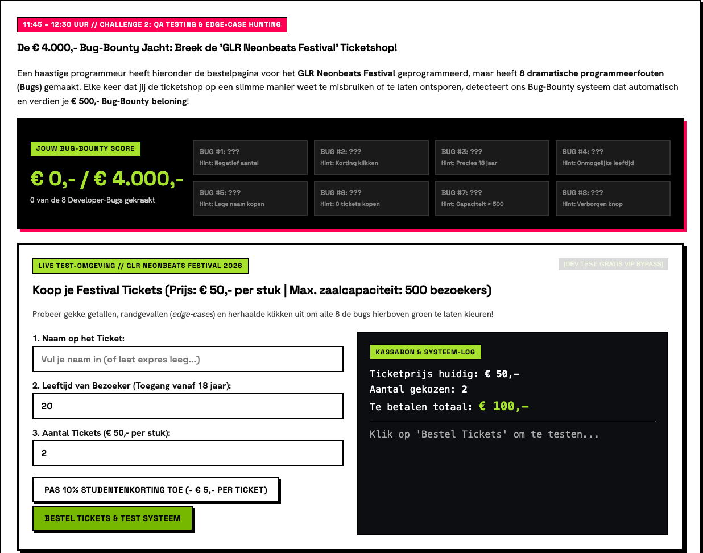
    <p class="d3-cap">Reader · tab 03 · Deel A · scorebord en ticketshop</p>
  </div>
</div>
<div class="footer"><span>CSD Oriëntatieklas · Dag 3 · Developer Mindset</span><span class="num">10</span></div>

Note: Fase 6 DIM — zelfstandig in duo's (±35 min). Oplossingen (niet tonen; ook via Shift + Alt + D): 1) negatief aantal tickets, bijv. -5; 2) drie keer of vaker op de kortingsknop klikken; 3) leeftijd precies 18; 4) onmogelijke leeftijd, onder 0 of boven 130; 5) naam leeg laten; 6) precies 0 tickets; 7) meer dan 500 tickets; 8) het half-doorzichtige knopje [DEV TEST: GRATIS VIP BYPASS] rechtsboven in de shop. De hints staan al in de bug-vakjes van het scorebord. Loop rond met de vraag: "Welke invoer heb je nog niet geprobeerd?" Duo's die alle 8 hebben: laat ze per bug in één zin opschrijven hoe de developer het had moeten voorkomen. Om 12:25 stoppen voor de oogst.

---

<p class="kicker">Oogst · 12:25 · wat hebben jullie ontdekt?</p>
<h2 class="title title--md">Een developer vertrouwt nooit wat een gebruiker invult</h2>
<div class="rows">
  <div class="listrow fragment"><span class="n">01</span><div><h3>Welke bug vond jij het slimst, en waarom?</h3><p>Twee duo's vertellen.</p></div></div>
  <div class="listrow fragment"><span class="n">02</span><div><h3>Wat kost zo'n fout een echt festival?</h3><p>Gratis tickets, een te volle zaal, geld terug voor niets.</p></div></div>
  <div class="listrow fragment"><span class="n">03</span><div><h3>Bedrijven betalen hier echt voor</h3><p>Bij een bug-bounty krijg je geld als je een fout netjes meldt in plaats van misbruikt.</p></div></div>
</div>
<div class="footer"><span>CSD Oriëntatieklas · Dag 3 · Developer Mindset</span><span class="num">11</span></div>

Note: Fase 7 DIM — nabespreking (±5 min). Vraag eerst uit de klas en klap daarna de punten aan. Vraag per genoemde bug: "Hoe had de developer dit kunnen voorkomen?" (controleren of het getal groter dan 0 is, >= gebruiken, de testknop weghalen voor de livegang). Benoem de rol: dit is wat een tester of QA-engineer doet, en ook een AV- of mediamanager moet zo kunnen denken bij een online kaartverkoop. Studenten vinken het Hacker Lab-deel van Quest 3.1 af in de reader.

---

<!-- .slide: class="dark" data-background-color="#111111" -->

<p class="kicker kicker--lime">Lunchpauze · 12:30 – 13:00</p>
<h2 class="title" style="color:#fff;font-size:72px;line-height:1;margin-top:12px">Na de lunch bouw je verder met je micro:bit.</h2>
<p class="lede" style="color:#EDEDED;font-size:24px;margin-top:12px">Om <strong style="color:#A6E22E">13:00</strong> gaan we verder met Deel B. Zelfde duo, zelfde plek, je bordje ligt klaar.</p>
<div class="timer" data-timer="30:00" role="group" aria-label="Timer 30 minuten lunchpauze" style="margin-top:8px;transform:scale(.78);transform-origin:top center">
  <div class="t-dial">
    <svg viewBox="0 0 120 120" aria-hidden="true">
      <circle class="t-track" cx="60" cy="60" r="54"></circle>
      <circle class="t-prog" cx="60" cy="60" r="54"></circle>
    </svg>
    <div class="t-face"><span class="t-time">30:00</span><span class="t-label">Lunch</span></div>
  </div>
  <div class="t-btns"><button class="t-btn t-start" type="button">Start</button><button class="t-btn t-reset" type="button">Reset</button></div>
</div>
<div class="footer"><span>CSD Oriëntatieklas · Dag 3 · Developer Mindset</span><span class="num">12</span></div>

Note: Lunchpauze 12:30–13:00. Start de timer. Laat de micro:bits op de tafels liggen (kabel los). Tel de sets (20 micro:bits, 20 kabels) zodat je bij de inname weet wat er terug moet komen.

---

<p class="kicker">Deel B · stap 1 · 13:00–13:30 · beginnercursussen</p>
<h2 class="title title--md">Eerst leer je de drie bouwstenen: scherm, knoppen en schudden</h2>
<div class="cards">
  <div class="glr-card">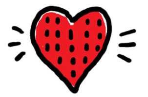<span class="k">Scherm</span><h3>Knipperend hart</h3><p>Tekenen op de LED's en eindeloos herhalen.</p></div>
  <div class="glr-card">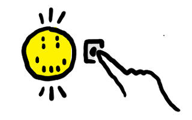<span class="k">Knoppen</span><h3>Smiley-knoppen</h3><p>Knop A is blij, knop B is verdrietig.</p></div>
  <div class="glr-card">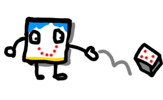<span class="k">Schudden</span><h3>Dobbelsteen</h3><p>Schud en krijg een willekeurig getal.</p></div>
</div>
<p class="body" style="margin-top:16px;font-size:21px">Twee cursussen werkend (Knipperend hart telt al)? Door naar stap 2. Al eens gedaan? Begin meteen bij stap 2.</p>
<div class="footer"><span>CSD Oriëntatieklas · Dag 3 · Developer Mindset</span><span class="num">13</span></div>

Note: Fase 6 DIM — zelfstandig in duo's, Stap 1 (tot 13:30). Ze zijn om 11:15 al begonnen met Knipperend hart; laat ze verder gaan waar ze bleven. Te vinden in de rij "Zelfstudies" op het MakeCode-startscherm (ook Naamplaatje hoort erbij). Kernbegrippen: LED-matrix en de forever-lus, event-input via knop A en B, bewegingssensor (on shake) + willekeurig getal. Doorstroomregel: wie 2 beginnercursussen werkend heeft (of ze al kende) gaat door naar Stap 2. Laat duo's om de beurt slepen en downloaden. In de reader: tab 03 → Deel B → knop "Stap 1". Illustraties: Microsoft MakeCode.

---

<p class="kicker">Deel B · stap 2 · 13:30–14:05 · spellen</p>
<h2 class="title title--md">Nu bouw je een spel dat je tegen je tafelbuur speelt</h2>
<div class="cards">
  <div class="glr-card">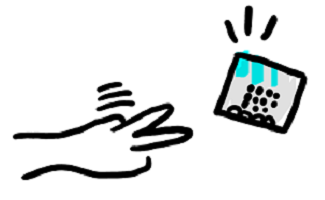<span class="k">1 tegen 1</span><h3>Steen, papier, schaar</h3><p>Schud tegelijk. Speel een best-of-5.</p></div>
  <div class="glr-card">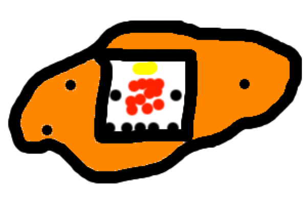<span class="k">Hele tafel</span><h3>Hete aardappel</h3><p>Een tikkende tijdbom die je snel doorgeeft.</p></div>
  <div class="glr-card">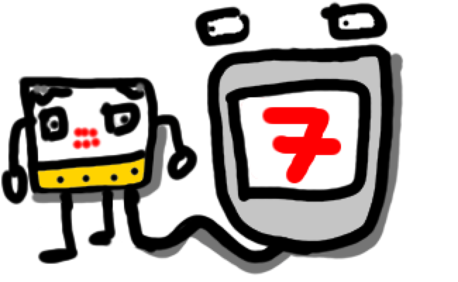<span class="k">Solo of duel</span><h3>7 seconden</h3><p>Wie heeft de beste interne klok?</p></div>
</div>
<p class="body" style="margin-top:16px;font-size:21px">Vast? Eerst <strong>Boek</strong> (de zelfstudie), dan <strong>Buur</strong>, dan <strong>Baas</strong>.</p>
<div class="footer"><span>CSD Oriëntatieklas · Dag 3 · Developer Mindset</span><span class="num">14</span></div>

Note: Fase 6 DIM — zelfstandig in duo's, Stap 2 (±35 min). Rij "Spellen" op het MakeCode-startscherm. Steen, papier, schaar gebruikt on shake, kies willekeurig 1 tot 3 en als/anders; laat duo's daarna een best-of-5 toernooitje spelen tegen de tafelbuur. Hete aardappel: de micro:bit telt af en wordt fysiek doorgegeven. 7 seconden: druk precies na 7 seconden opnieuw. Voor het doorgeven en schudden moet het bordje los van de iMac: kan alleen met een batterijhouder; zonder batterij blijft de kabel erin en wordt er voorzichtig geschud. Rond 13:55 de begripscheck op de volgende slide.

---

<p class="kicker">Begripscheck · steek 1, 2 of 3 vingers op</p>
<h2 class="title title--md">Jij en je buur schudden tegelijk. Kunnen jullie allebei “steen” krijgen?</h2>
<div class="rows rows--tight">
  <div class="listrow"><span class="n">1</span><div><h3>A · Nee, de micro:bits spreken af wie wat krijgt</h3></div></div>
  <div class="listrow"><span class="n">2</span><div><h3>B · Ja, elk bordje kiest zelf een willekeurig getal</h3></div></div>
  <div class="listrow"><span class="n">3</span><div><h3>C · Nee, na steen komt altijd papier</h3></div></div>
</div>
<div class="footer"><span>CSD Oriëntatieklas · Dag 3 · Developer Mindset</span><span class="num">15</span></div>

Note: Fase 4 DIM — begripscheck (±3 min, rond 13:55). Juist: B (2 vingers). Elk bordje voert zijn eigen programma uit en kiest zelf een willekeurig getal van 1 tot 3; ze weten niets van elkaar. Beslisprotocol: >80% goed → één student laat het uitleggen; 30–80% → 60 sec overleg + herstemming; <30% → laat twee studenten tien keer schudden en turven. Dit is de brug naar Stap 3: "Ze weten nu niets van elkaar. Hoe zou je ze wél met elkaar kunnen laten praten?"

---

<!-- .slide: class="dark" data-background-color="#111111" -->

<p class="kicker kicker--lime">Deel B · stap 3A · 14:05–14:20 · iedereen · verplicht</p>
<h2 class="title title--md" style="color:#fff">Met drie blokken wordt je micro:bit een walkie-talkie</h2>
<div class="row" style="margin-top:10px;align-items:center">
  <div class="col" style="flex:1 1 62%">
    <div class="rows" style="margin-top:0">
      <div class="listrow"><span class="n" style="color:#A6E22E">1</span><div><h3 style="color:#fff"><span class="d3-block">radio stel groep in op 1</span></h3><p style="color:#EDEDED">Jullie kanaal. Zelfde nummer als je buur, anders hoor je niets.</p></div></div>
      <div class="listrow"><span class="n" style="color:#A6E22E">2</span><div><h3 style="color:#fff"><span class="d3-block">radio verzend tekenreeks</span></h3><p style="color:#EDEDED">Met knop A stuur je een bericht de lucht in.</p></div></div>
      <div class="listrow"><span class="n" style="color:#A6E22E">3</span><div><h3 style="color:#fff"><span class="d3-block">wanneer radio ontvangt</span></h3><p style="color:#EDEDED">Het bericht van je buur verschijnt op jouw LED's.</p></div></div>
    </div>
  </div>
  <div class="col" style="flex:1 1 38%;text-align:center">
    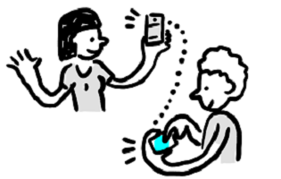
    <p class="d3-cap" style="color:#BBB">Zelfstudie Micro-Chat (Glimlachen sturen)</p>
  </div>
</div>
<div class="footer"><span>CSD Oriëntatieklas · Dag 3 · Developer Mindset</span><span class="num">16</span></div>

Note: Fase 3/5 DIM — korte instructie, daarna doen (±15 min). Stop iedereen om 14:05, ook wie nog in een spel zit: de radiospellen zijn meteen complex als je de radio-blokken niet kent, daarom doet iedereen eerst Micro-Chat. Te vinden in de rij "Zelfstudies" op MakeCode of via de knop "START STAP 3A" in de reader (makecode.microbit.org/projects/micro-chat). Leg de walkie-talkie-metafoor uit: groep = frequentie. Laat elk duo-paar een eigen groepsnummer kiezen (tafelnummer), anders ontvangt iedereen alles door elkaar. In de simulator verschijnt vanzelf een tweede virtuele micro:bit zodra je een radio-blok gebruikt. Gelukt = een smiley van de ene micro:bit verschijnt op de andere.

---

<p class="kicker">Deel B · stap 3B · 14:20–14:40 · radiospellen</p>
<h2 class="title title--md">Micro-Chat gelukt? Dan speel je nu draadloos tegen elkaar</h2>
<div class="cards">
  <div class="glr-card">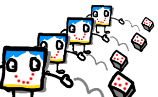<span class="k">Radiospel</span><h3>Multi-dobbelsteen</h3><p>Iedereen schudt: het hoogste getal wint, draadloos vergeleken.</p></div>
  <div class="glr-card">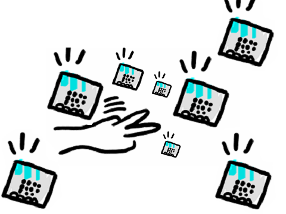<span class="k">Radiospel</span><h3>Steen, papier, schaar Teams</h3><p>De hele tafel speelt mee en ziet hoeveel spelers elk team heeft.</p></div>
  <div class="glr-card glr-card--accent"><span class="k">Nog niet zover?</span><h3>Maak eerst Micro-Chat af</h3><p>Stuur daarna je eigen icoon of een woord naar je buur. Dat telt ook.</p></div>
</div>
<div class="footer"><span>CSD Oriëntatieklas · Dag 3 · Developer Mindset</span><span class="num">17</span></div>

Note: Fase 6 DIM — zelfstandig in duo's, Stap 3B (±20 min). Rij "Radiospellen" op het MakeCode-startscherm; links ook in de reader onder Stap 3. Pas starten nadat Micro-Chat tussen twee echte micro:bits werkt. Multi-dobbelsteen: makecode.microbit.org/projects/multi-dice. RPS Teams: makecode.microbit.org/projects/rps-teams. Ook Hete aardappel via radio (Tele-potato) is een optie. Let op de groepsnummers: twee duo's die samen spelen zetten dezelfde groep. In de reader staat een bonus-spiekbriefje met de Micro-Chat-code voor wie vastloopt. Illustraties: Microsoft MakeCode.

---

<!-- .slide: class="dark" data-background-color="#111111" -->

<p class="kicker kicker--lime">14:40 · klas-finale</p>
<h1 class="title" style="color:#fff;font-size:96px;line-height:0.95;margin-top:30px">Iedereen naar <span class="glr-glow" style="color:#A6E22E">groep 99</span></h1>
<p class="lede" style="color:#EDEDED;font-size:28px;max-width:900px;margin-top:22px">Zet je Micro-Chat op <span class="d3-block">radio stel groep in op 99</span> en download opnieuw. Eén druk op knop A, en de hele klas licht op.</p>
<div class="footer"><span>CSD Oriëntatieklas · Dag 3 · Developer Mindset</span><span class="num">18</span></div>

Note: Optionele klas-finale (±5 min, 14:40). Iedereen opent zijn Micro-Chat-project, verandert het groepsnummer in 99 en downloadt opnieuw. Tel af: één student drukt op knop A en alle bordjes in het lokaal tonen het bericht. Laat daarna iedereen tegelijk drukken voor de chaos-versie. Benoem wat ze zien: zo werkt elk draadloos netwerk, iedereen op hetzelfde kanaal hoort alles. Loopt de tijd uit, sla deze slide dan over en ga naar de inname.

---

<p class="kicker">14:45 · inleveren · vink je quests af · OVG</p>
<h2 class="title title--md">Wat heb jij vandaag gekraakt en gebouwd?</h2>
<ul class="check">
  <li><strong>Quest 3.1</strong> — de kluis of de bug-bounty gekraakt én de beginnercursussen afgerond.</li>
  <li><strong>Quest 3.2</strong> — een spel gebouwd en gespeeld op de micro:bit.</li>
  <li><strong>Quest 3.3</strong> — eerst Micro-Chat, daarna een radiospel met een ander bordje.</li>
</ul>
<p class="body" style="margin-top:16px;max-width:940px"><strong>Eerst inleveren:</strong> kabel los, micro:bit en kabel per tafel terug in de bak. Daarna vink je af in de reader.</p>
<div class="footer"><span>CSD Oriëntatieklas · Dag 3 · Developer Mindset</span><span class="num">19</span></div>

Note: Fase 7 DIM + formatieve OVG-check (±5 min). Neem de 20 micro:bits en 20 USB-kabels gestructureerd in: per tafel laten brengen en zelf tellen voordat iemand verder gaat. Daarna vinken studenten zelf de quests af in de reader (tab 03 → Deel B → Jouw Quests voor Dag 3). Geen cijfer, wel bewijs van eigen kunnen. Snelle handopsteek per quest.

---

<p class="kicker">Afsluiting · reader tab 04 · GLR Kompas</p>
<h2 class="title title--md">Welke rol paste deze week het best bij jou?</h2>
<div class="cards">
  <div class="glr-card"><span class="k">Rol A</span><h3>Vormgeving, 3D, animatie</h3><p>Je richtte het liefst de sfeer, de kleuren en de 3D-werelden in.</p></div>
  <div class="glr-card"><span class="k">Rol B</span><h3>AV, podium, mediamanagement</h3><p>Beleven, testen, kraken en regisseren gaf je de meeste energie.</p></div>
  <div class="glr-card glr-card--accent"><span class="k">Rol C</span><h3>Creative Software Developer</h3><p>Je dook graag onder de motorkap om het echt te laten werken.</p></div>
</div>
<p class="body" style="margin-top:16px;font-size:21px">Vink jouw rol aan op <strong>tab 04</strong> en lees je GLR-toekomstbericht.</p>
<div class="footer"><span>CSD Oriëntatieklas · Dag 3 · Developer Mindset</span><span class="num">20</span></div>

Note: Fase 7 DIM — terugblik en studiekeuze (±5 min). Studenten openen Tab 04 (04 // GLR Kompas) en vinken de rol aan die hen deze week het meest aansprak; de reader toont dan een persoonlijk toekomstbericht. Elke keuze is goed: het doel van de oriëntatieklas is ontdekken wat bij je past. Vraag 2–3 studenten welke rol ze kozen en welk moment van de week dat bepaalde.

---

<p class="kicker">Wat neem je mee</p>
<h2 class="title title--md">Vormgever, filmmaker of developer: op het GLR maak je het samen</h2>
<div class="rows">
  <div class="listrow fragment"><span class="n">01</span><div><h3>Dag 1 · je tekende met code</h3><p>p5.js: visuals en een eigen game in 2D.</p></div></div>
  <div class="listrow fragment"><span class="n">02</span><div><h3>Dag 2 · je stapte een 3D-wereld in</h3><p>A-Frame en de Meta Quest 2.</p></div></div>
  <div class="listrow fragment"><span class="n">03</span><div><h3>Dag 3 · je keek onder de motorkap</h3><p>Broncode, bugs en een computer in je hand.</p></div></div>
</div>
<p class="body fragment" style="margin-top:16px">Welke opleiding je ook kiest: je weet nu wat een developer in jouw team kan.</p>
<div class="footer"><span>CSD Oriëntatieklas · Dag 3 · Developer Mindset</span><span class="num">21</span></div>

Note: Fase 7 DIM — transfer en positieve afsluiting (tot 15:00). Kernboodschap voor de studenten die een andere GLR-opleiding kiezen: later werk je in projecten samen met developers, en nu weet je hoe zij denken (kijk onder de buitenkant, probeer het kapot te krijgen, bouw het in kleine stappen). Voor wie Rol C aanvinkte: nodig uit om na afloop even te blijven voor vragen over de opleiding CSD. Bedank de klas en sluit af.

---

<!-- .slide: class="bleed dark" data-background-color="#111111" -->

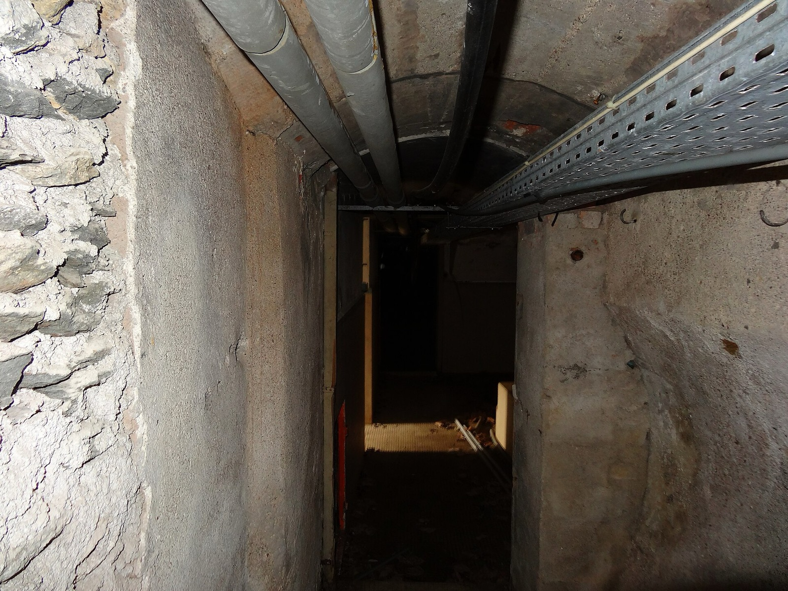
<div class="bleed-overlay bleed-overlay--soft"></div>
<div class="bleed-content">
  <p class="kicker kicker--lime">14:00 · we gaan naar beneden</p>
  <h1 class="title" style="color:#fff;font-size:100px;line-height:0.95;margin-top:60px">Durf jij het<br><span class="glr-glow" style="color:#A6E22E">spookhuis</span> in?</h1>
  <p class="lede" style="color:#fff;font-size:30px;max-width:640px;margin-top:26px">Om <strong style="color:#A6E22E">14:00</strong> lopen we samen naar de <strong style="color:#A6E22E">PET-studio in de kelder</strong>. Tas mee, micro:bit blijft hier.</p>
  <p style="margin:auto 0 0;font-size:12px;color:#AAA">Foto: “The Basement”, Falcon® Photography, Wikimedia Commons (CC BY-SA 2.0)</p>
  <div class="footer"><span>CSD Oriëntatieklas · Dag 3 · Developer Mindset</span><span class="num">22</span></div>
</div>

Note: Om 14:00 gaat de hele klas naar de PET-studio in de kelder voor het spookhuis. Zet deze slide een paar minuten van tevoren op het scherm. Neem vóór vertrek de micro:bits en USB-kabels in (tel 20 + 20) en laat de quests en het GLR Kompas afvinken, of doe dat na terugkomst. Loop als groep naar beneden.
